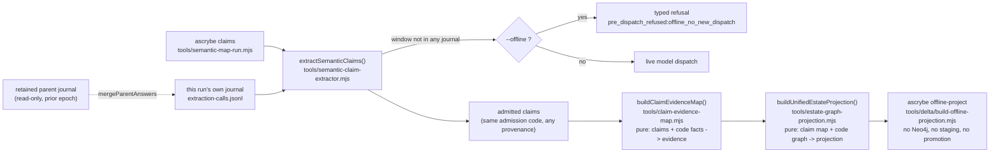

# Delta-updatable estate maps: documentary claims, binding, and projection status

**BLUF:** [Delta-updatable estate maps](delta-updatable-estate-maps.md)'s file-scope half
(deterministic extraction, merge, remap) is covered by
[docs/delta-file-scope-implementation-status.md](delta-file-scope-implementation-status.md). This
document covers the three stages above it: the paid documentary read, deterministic evidence
binding, and projection. Binding and projection need no new reuse mechanism at all — they are
already pure functions of their inputs, so equal inputs produce byte-identical output by
construction. The one stage that genuinely costs money — the documentary read — gets a real reuse
mechanism (`tools/delta/documentary-reuse.mjs`), because it is the one stage where "recompute it
again" is not free. All names in this document are invented (`CONTRIBUTING.md`).

## What is implemented

| Design element | Module |
|---|---|
| Paid-request identity and reuse, keyed on the exact rendered prompt (never a source pin) | `tools/delta/documentary-reuse.mjs` (`planDocumentaryReuse`, `mergeParentAnswers`) |
| A ModelRunner that never dispatches, for zero-spend planning | `tools/delta/documentary-reuse.mjs` (`offlineNoDispatchRunner`) |
| CLI wiring: `--reuse-journal label=path` (repeatable), `--offline` | `tools/semantic-map-run.mjs` |
| An offline, pure-function projection artifact (no database, no staging, no promotion) | `tools/delta/build-offline-projection.mjs`, `ascrybe offline-project` |
| A runner-reported `dispatched: false` signal, counted as `offline_refusals`, never `model_calls` | `tools/semantic-claim-extractor.mjs` (`extractSemanticClaims`), set by `offlineNoDispatchRunner()` |
| Model-scoped reuse: a journal entry records its own model; reuse across a model change is refused unless explicitly asserted | `tools/delta/documentary-reuse.mjs` (`loadAnswerJournal({expected_model})`, `backfillJournalModel()`) |

### Paid-answer reuse: how identity already excludes the source pin

`tools/semantic-claim-extractor.mjs`'s `extractSemanticClaims()` has, since before this delta work
began, reused an answer from its own run's journal for resumability — keyed on
`prompt_digest = sha256(prompt)`, where `buildExtractionPrompt()` renders only a window's document
path, its author's own section outline, and its numbered content. It never renders a commit SHA,
a pin set, or any code fact. Two commits that leave a document's bytes untouched therefore render
the *exact same prompt* for that document's windows, and the exact same digest — so
`docs/delta-updatable-estate-maps.md`'s "excluded from paid-request identity ... only when the
rendered prompt does not contain them" already holds for this extractor, by construction, not by a
new field this work added.

`tools/delta/documentary-reuse.mjs` reuses that *same* identity across epochs instead of adding a
second one: `mergeParentAnswers()` copies every `outcome: 'ok'` row from one or more retained,
read-only parent journals into the current run's own journal *before* extraction starts — so the
window is served by `extractSemanticClaims()`'s existing, already-tested journal-hit path, not a
new admission code path. A reused row keeps every original field (`answer`, `outcome`, `usage`,
`answer_digest`) byte-for-byte and adds only `reused_from_parent` for custody — "it must never
rewrite old bytes as if the current producer emitted them."

`planDocumentaryReuse()` is the read-only counterpart: given the current document scope and one or
more parent journals, it reports which windows would be reused (and from which parent, in priority
order) and which are new, at zero cost and with no side effect — a plan, not an action.

### Model-scoped reuse

`paid_request_identity` includes the model, provider, and route — an answer from one model is not
interchangeable with an answer from another, even for a byte-identical prompt. `extractSemanticClaims`
now records `model` on every journal entry it writes. `loadAnswerJournal`'s optional `expected_model`
restricts a journal to entries recorded under exactly that model; an entry with no recorded model at
all (every journal written before this field existed) is refused under model-scoped loading rather
than assumed to match. `backfillJournalModel()` makes an old journal's provenance explicit, once, as
its own auditable step — never inferred at reuse time — and refuses to relabel a file that already
names a *different* model for any entry, rather than silently overwriting genuinely mixed
provenance. Omitting `expected_model` entirely is unchanged from before this parameter existed:
permissive loading, for a caller that does not need model scoping.

### An honest call counter

Before this revision, `extractSemanticClaims`'s `model_calls` counted every window that reached
`runner.complete()` — correct for a live runner, misleading for an offline one: a zero-spend plan
run through `offlineNoDispatchRunner()` still reported a nonzero `model_calls`. A runner may now
return `dispatched: false` on its response; that outcome is counted under the new `offline_refusals`
field instead, and excluded from cost accounting the same way an uncalled (null-byte-refused) window
already was. Omitting the field (every runner written before it existed) is unchanged: a live call,
counted under `model_calls`, exactly as before.

### Why binding and projection need no cache

`tools/claim-evidence-map.mjs`'s `buildClaimEvidenceMap()` and
`tools/estate-graph-projection.mjs`'s `buildUnifiedEstateProjection()` are both pure functions:
given the same claim set, code facts, and tree, they produce byte-identical output — no filesystem
read beyond their declared inputs, no database call, no clock, no randomness
(`tests/delta-offline-projection.test.mjs` proves the second of these by calling it twice on the
same input and comparing digests). A delta run therefore does not need a *binding cache* or a
*projection cache* to be correct: it needs the CLAIM SET the delta path produces to equal the claim
set a full rebuild would produce (paid-answer reuse's job, above), and correct binding/projection
follow for free from equal inputs into the same pure function.

`ascrybe offline-project` makes that comparison something you can actually run: it drives
`buildUnifiedEstateProjection()` from a claim map and code graph already on disk and writes the
projection's `content_digest` to a receipt, without opening a database connection, staging a
working generation, or promoting. Two projections are equivalent exactly when their
`content_digest`s match.

## What the full-rebuild oracle means at this layer, and why it differs from the file-scope layer

The file-scope layer's oracle (`docs/delta-file-scope-implementation-status.md`) is a real
side-by-side rebuild, because deterministic extraction is nearly free: running it twice and diffing
is the honest check. The documentary layer cannot use that same oracle, because a model call is
neither free nor deterministic — dispatching the *same* prompt twice is not guaranteed to return
the *same* answer, so "run it again and compare" is not a meaningful equivalence check here, and
would also defeat the entire purpose of reuse (a mode that must re-pay for a window to prove reuse
worked has not saved anything).

`docs/delta-updatable-estate-maps.md` already resolves this: **`--mode full` "reads the declared
immutable paid-answer/inference artifacts and never dispatches a model."** A full rebuild at the
documentary layer means recomputing every deterministic thing fresh while reading whichever paid
answers already exist from custody — never a new live call as its own oracle. This document adopts
that reading explicitly: the documentary layer's equivalence oracle is **dispatch-decision
correctness** (every window is classified as reuse-eligible or new correctly, deterministically,
with no live call involved in the check) plus **custody preservation** (a reused answer's bytes are
provably the original ones) plus **admission determinism** (the same admission code produces the
same claim from the same answer bytes regardless of whether they arrived by a live call or a
journal hit — true today because `admitProposal()` never inspects provenance). It is not, and
cannot be, "identical to a hypothetical second live dispatch."

## Known limitations, unchanged by this work

These are named in `docs/delta-file-scope-implementation-status.md` and carried forward rather than
duplicated: the CLI delta path's scan scope differs from the ordinary `extract` path's, so a unit ID
from one does not currently match a unit ID from the other; `.estate-mapignore` is not read by the
delta path; and the documentary extractor's raw-byte read has no redaction pass. A clean fixture
is not an enforced guarantee that an arbitrary input is secret-free. A new limitation specific
to this layer: because model output is not guaranteed deterministic for identical input, a window
answered fresh at two different epochs can legitimately produce two different (both individually
valid) answers — reuse deliberately keeps the *original* one rather than either discarding it or
demanding they match, and a qualification run that measures how often two independent live answers
to the same prompt agree is reporting the model's own consistency, not a defect in reuse. Reuse's
job is to preserve the retained answer exactly, not to predict a hypothetical second draw.

A path rename remains delete-plus-add without an identity-continuity claim. Multi-hop reuse
requires an exact comparison with a forced-full reference at each hop.

## Qualification beyond fixtures

Live projection roundtrips and paid multi-repository campaigns require separate operator-authorized
qualification. Verify readback equality, preserve existing projection heads, and bind claims against
nonempty code facts. Keep private inputs, provider incidents, costs, and results in external custody.
The public fixture battery does not certify those private operating conditions.

## What a future implementer needs

Rename continuity, repository/global-scope units, and deterministic migration remain out of scope
here exactly as in the file-scope layer, for the same reason: they are a different seam
(`tools/delta/scope-refusals.mjs`), not one this slice touches. A live, credentialed implementer
still owns wiring any of this into `tools/estate-graph-projection.mjs`'s real staging/promotion
path — `ascrybe offline-project` deliberately stops short of that, by design, not by omission.
