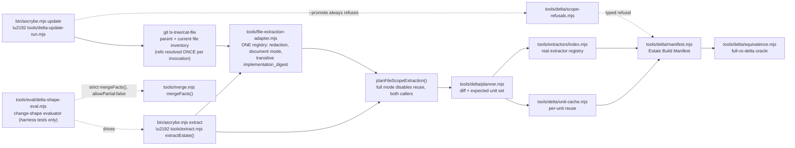
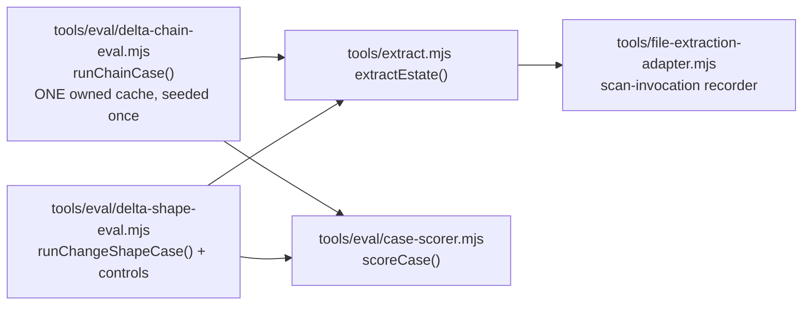

# Delta-updatable estate maps: file-scope implementation status

**BLUF:** [Delta-updatable estate maps](delta-updatable-estate-maps.md) is a design for the whole
estate-update problem. `tools/delta/` implements only its **file-scope half** as a library surface:
exact identity formulas, per-unit cache reuse, a delta planner, an Estate Build Manifest, and a
full-vs-delta equivalence oracle. Everything else the design describes is either an explicit typed
refusal or a named absence below — never a silent gap, never a partial implementation presented as
complete. All names in this document and in `tools/delta/`'s tests are invented
(`CONTRIBUTING.md`).

The layers above this one — the paid documentary read, deterministic evidence binding, and
projection — are covered separately in
[docs/delta-documentary-update-status.md](delta-documentary-update-status.md); this document's
scope stops at merge/remap, exactly as it always has.



## What is implemented

| Design element | Module |
|---|---|
| `observation_id`, `payload_unit_id`, `record_digest`, `input_receipt_digest`, `producer_contract_digest`, `producer_content_digest`, `build_scope_digest`, `build_membership_binding`, `semantic_content_digest`, `build_id` (file scope) | `tools/delta/identity.mjs` |
| Extraction Unit Receipt v1 (file scope): produced/refused construction, disposition relabeling for reuse, full self-recomputation/validation | `tools/delta/extraction-unit.mjs` |
| Per-unit extraction cache: keyed by `payload_unit_id`, not by whole estate Git head; fail-closed on corruption (quarantine + recompute) | `tools/delta/unit-cache.mjs` |
| Delta planner: added/unchanged/modified/deleted diff, expected unit enumeration, exhaustive-disposition totality validator | `tools/delta/planner.mjs` |
| Estate Build Manifest v1 assembly with non-throwing conservation checks (unit-partition, path-partition, observation-ID-uniqueness) | `tools/delta/manifest.mjs` |
| Full-vs-delta equivalence oracle | `tools/delta/equivalence.mjs` |

`bin/ascrybe.mjs`'s `update` verb (`tools/delta-update-run.mjs`) wires this library surface to a
real, Git-plumbing-read repository and the real `tools/extractors/index.mjs` registry: it is a
non-test production caller of `tools/delta/`, and it replaces whole-estate-Git-head cache keying
(`tools/extraction-cache.mjs`'s `buildExtractionCacheBinding`) with per-unit reuse keyed by
`payload_unit_id` for everything it plans. `tools/extraction-cache.mjs` itself is untouched and
remains live, unmodified, for `tools/code-grounded-assertions.mjs`'s unrelated paid-claim cache.
This verb does not run against a live estate (it reads Git plumbing only, never a checkout, never
Neo4j), and it does not touch promotion, CAS, GC, or lease behavior: it never imports
`tools/estate-graph-projection.mjs` and `--promote` is always a typed refusal, so nothing here can
change what the `selected` or `working` generation serves.

**SHARED PATH (this revision).** `tools/extract.mjs` (`extractEstate()`, and therefore every one of
its callers, including `tools/semantic-map-run.mjs`'s paid claims run) and `tools/delta-update-run.mjs`
now build their per-file/per-extractor registry through ONE module, `tools/file-extraction-adapter.mjs`:

| Concern | Before this revision | Now |
|---|---|---|
| Redaction / document-mode classification | Duplicated: `tools/extract.mjs` had its own copy; `tools/delta-update-run.mjs` had a second, hand-transcribed copy | One implementation (`withholdSecrets`/`redactLines`/`documentModeFor`), imported by both |
| `implementation_digest` | `sha256(canonical({..., scan: extractor.scan.toString()}))` — the extractor function's own source text only | `moduleClosureDigest()`: the extractor's own module file PLUS its transitive local-import closure PLUS (for tree-sitter-backed extractors) every query byte under `tools/treesitter/queries` |
| Reuse in `tools/extract.mjs` | None — every run recomputed every unit | `extractEstate(estate, out, { cache: { root, mode } })`; `mode: 'full'` (or omitting `cache` entirely) reproduces the old always-recompute behavior byte-for-byte |
| Ref resolution in `ascrybe update` with `--equivalence required` | `planEstateUpdate()` called twice (once per arm), each independently resolving refs and re-fetching every blob | `resolveEstateInventory()` resolves once; both arms plan from the same resolved inventory |
| Scan-scope exclusions in `ascrybe update` | None — every git-tracked regular blob (including `node_modules/`, `dist/`, etc.) became a delta unit | `tools/lib.mjs#classifyExcludedPath` applied to every inventoried path, matching `tools/extract.mjs`'s `walk()`. `.estate-mapignore` IS now applied too, read via Git plumbing per declared repository (`tools/delta-update-run.mjs#gitEstateMapIgnorePrefixes`, `tools/lib.mjs#parseEstateMapIgnoreLines`/`isIgnoredPath`) — no live checkout needed, since the file is itself a tracked blob at the ref |
| Catalog-glob scope in `ascrybe update` | Hardcoded `[]` regardless of the ordinary path's configured `catalog_globs` | Defaults to the resolved `--runtime-config`'s own `catalog_globs` field (`update` is now `config: true` in `bin/ascrybe.mjs`, so it auto-resolves the SAME `ascrybe.config.json` every other estate-facing verb does; a config file absent at that path is not an error). `--catalog-globs <path>` overrides it with a standalone array. Both share one validation rule (`tools/ascrybe-config.mjs#validateCatalogGlobs`) — with the same `.estate-mapignore` and `catalog_globs` on both sides (default OR explicit), `tests/delta-scope-parity.test.mjs` proves the delta and ordinary paths expect the exact same (file, extractor) unit set, not merely an explained difference |

Cache/disposition telemetry (`_CACHE_TELEMETRY.json` for `extract`, `cache-telemetry.json` for
`update`) is a receipt SEPARATE from facts/`_MANIFEST.json`/`estate-build-manifest.json`: a cold,
warm, and forced-full run over the same source/config produce byte-identical facts and manifest
content, and differ only in that telemetry (tests/shared-file-extraction-adapter.test.mjs,
tests/delta-shared-path-update.test.mjs). `tools/project-estate-map.mjs` is still not wired to any
of this.

## What is an explicit typed refusal (`tools/delta/scope-refusals.mjs`)

| Capability | Reason code | Why |
|---|---|---|
| Repository-scope units | `DELTA_REPOSITORY_SCOPE_NOT_IMPLEMENTED` | Only the `file` observation-identity scope is implemented; `observationId()` and `recomputeAndValidateReceipt()` both refuse a `repository`-kind scope rather than forcing it through file-shaped identity. |
| Global-scope units | `DELTA_GLOBAL_SCOPE_NOT_IMPLEMENTED` | Same mechanism, for `global`-kind scope. An Estate Build Manifest from this slice always reports zero global units — a structural fact about what this planner routes to, not a computed-and-verified-empty claim. |
| Deterministic migrations | `DELTA_MIGRATION_NOT_IMPLEMENTED` | A breaking extractor change re-extracts (new `unit_id`, disposition `produced`) or is refused; no converter/migration-receipt path exists. |
| Rename continuity | `DELTA_RENAME_CONTINUITY_NOT_IMPLEMENTED` | The planner records an advisory `rename_candidates` list (matching content hash, informational only) but always resolves a rename as delete-plus-add, per the design's own default: "A rename is always delete-plus-add because `normalized_path` is part of `observation_id`." |
| Paid-answer / campaign reuse | `DELTA_PAID_ANSWER_REUSE_NOT_IMPLEMENTED` | No `paid_request_identity`, no model dispatch, no campaign custody. This slice is deterministic file-scope extraction only. |
| `ascrybe update` projection publish | `DELTA_UPDATE_PROJECTION_PUBLISH_NOT_IMPLEMENTED` | The `ascrybe update` verb now exists (`bin/ascrybe.mjs`'s command table, `tools/delta-update-run.mjs`) and runs the real planner/manifest/equivalence pipeline, but it never binds a projection, stages a working generation, or promotes. `--promote` is refused unconditionally, verified against live source in `tests/delta-scope-honesty.test.mjs` and exercised end-to-end in `tests/delta-update-cli.test.mjs`. |

Each refusal is independently callable (`requestRepositoryScopeUnit()`, `requestGlobalScopeUnit()`,
etc.) and carries a distinct reason code. An Estate Build Manifest field the design types as a
digest but which this slice cannot honestly compute (`downstream.campaign_receipt_digest`,
`downstream.projection_input_digest`, and the `global_outputs`/`claim_outputs`/
`projection_content_digest` inputs to `semantic_content_digest`) is filled with
`scopeRefusalSentinel(capability)` — a digest that commits to the refusal reason itself, so it can
never be misread as "verified empty."

## Deviations from the design's illustrative JSON

The design's Extraction Unit Receipt v1 examples show only the `produced` disposition. A `refused`
disposition needs a machine-readable reason the illustrated shape has no slot for, so
`buildRefusedFileUnitReceipt()` adds `disposition.reason_code`/`disposition.reason`. This is
additive (existing formula fields are untouched) and is called out here per this task's "record
a typed deviation ... never diverge silently" instruction.

The design does not pin a sort key for `records_digest = SHA-256(canonical(sorted(output.records)))`.
This implementation sorts by each record's own canonical serialization — a total order over exact
record bytes that adds no dependency the identity formulas do not already commit to.

`manifest_digest` has no formula in the design's "Identity vocabulary" section; this implementation
computes it the same way `receipt_digest` is computed elsewhere in the design — `SHA-256(canonical(manifest
body without manifest_digest))` — for consistency with that idiom.

## Change-shape evaluator (`tools/eval/delta-shape-eval.mjs`)

A harness, separate from `tools/delta-update-run.mjs` itself, that drives the REAL ordinary
extraction path (`tools/extract.mjs` `extractEstate()` — the same producer `ascrybe extract`
calls, including its own repository/coverage facts, diagnostics, and scanned-file manifest) over
Git refs materialized through the SAME verified, blob-validated tree materialization
`tools/materialize-estate.mjs` uses (`tools/git-tree-source.mjs` `materializeExactGitTree`), never
a live checkout/stash of the caller's repository and never a raw in-memory git-plumbing
reconstruction standing in for real files on disk:

1. Materialize the parent and child refs once each, one exact tree per declared repository.
2. Run `extractEstate()` over the materialized PARENT into a fresh, isolated cache root (never
   reused across cases or a prior evaluator run).
3. Run `extractEstate()` over the materialized CHILD reusing ONLY that parent-seeded cache (the
   delta arm), and a second time with no cache (the forced-uncached reference arm).
4. Run `tools/merge.mjs` `mergeFacts()` **strictly** (`allowPartial: false`, no fallback) over each
   arm's own complete `facts/*.jsonl` + `_MANIFEST.json` output — never a hand-reconstructed subset
   of records, never a substitute repo/coverage record patched into a gap. A conservation-gate
   failure retains its full report (`error.conservationGates`) and typed exit code, never reduced
   to a bare message.

The evaluator compares the delta arm's ACTUAL reconstructed observation_id/record_digest multiset
against the forced-uncached reference (never a self-reported digest alone), the two arms' merged
graph digests (repository incident edges included), and derives expected-reusable units ONLY from
validated non-refused parent receipts plus the child's current expected-unit set. It also records
the raw Git change shape (added/modified/deleted) alongside routed changed-unit membership under
the pinned registry: a changed file with no matching non-excluded extractor is a `no_routed_change`
control, never evidence that changed code failed to invalidate anything. Every case and the whole
run carry an explicit `pass`/`fail`/`incomplete` verdict, and the CLI exit code reflects it (`0`
pass, `1` fail, `2` incomplete — missing required coverage, an inconclusive control, or an
input-completeness gap can never report as green).

It accepts an external, frozen case manifest naming real Git checkouts and parent/child refs — this
repository ships and tests no private manifest, path, or result; `tests/delta-shape-eval.test.mjs`
demonstrates it on invented small multi-repository Git estates (real HTTP routes, an npm dependency
declaration, imports, and documentation — not an empty graph) the test itself creates and destroys,
plus four controls (`reuse_none`, `reuse_all`, `dropped_record`, `corruption`) that each drive the
SAME production scoring path and must fail/pass for a named, checked reason — never a separate
self-declared-passed function. The operator's private two-estate campaign runs this harness against
real pins later, in the owning live session — not here (`./CONTRIBUTING.md` "Where work runs").
Extraction and merge are the only pipeline stages this harness exercises; it makes no
claim/binding/projection/quality-coverage assertion.

### Session-owned two-estate execution procedure (not run by this task)

The operator chose two private estates and specific change shapes to evaluate on them; this
repository never learns their names, paths, pins, or results (`./CONTRIBUTING.md` "Where work
runs"). The later owning session runs, for each of the two estates:

1. Materialize both a parent and a child pin for the estate (`ascrybe materialize` /
   `tools/materialize-estate.mjs`, or a direct Git checkout the session already holds).
2. Author a case manifest — outside this repository — naming that estate's real repository path(s)
   and the parent/child refs for each chosen change shape (content edit, add, delete, rename,
   multi-file, docs-only, ignored/unrouted-only, large change; include at least one chained update).
   Selection is frozen from the estate's actual Git history BEFORE running the evaluator.
3. Run `node tools/eval/delta-shape-eval.mjs --case-manifest <path> --work-dir <external-scratch>`
   (work dir outside this repository and outside the mapped estate, per the state-root custody rule
   in `./CONTRIBUTING.md`).
4. Record `coverage.missing` verbatim — a stratum not exercised is reported, never silently treated
   as passing.
5. Keep every result (paths, pins, records, timings) in the session's own private storage. This
   repository ships only the harness and its invented-fixture tests.

This procedure has **not** been run as part of this task — no such run occurred, and no
private estate byte, path, or result exists anywhere in this diff. What this task's own
automated evidence covers is bounded to **extraction and merge**: the delta plan's reconstructed
records compared against a forced-uncached reference, and one fresh downstream `tools/merge.mjs`
recomputation per arm. It does **not** exercise `ascrybe remap` (code-plane resolution), `ascrybe
claims` (the paid documentary read and its claim/binding semantics — deliberately unchanged by this
task), `ascrybe project` (graph projection/promotion), or any quality/coverage claim about a
mapped estate. Extraction+merge evidence is not a substitute for any of those, and this document
makes no claim that it is.

## Stateful chain evaluator, actual-scan telemetry, and the common case scorer

Three qualification gaps the change-shape evaluator above did not close, now closed by three small
additive artifacts. None of these change `tools/delta/`'s production identity/planner/cache/manifest
formulas, `tools/extract.mjs`'s facts/`_MANIFEST.json` output, or `ascrybe update`'s refusal set.



### [ACTUAL-SCANS] Real production extractor.scan() invocation telemetry

`tools/file-extraction-adapter.mjs` `createScanInvocationRecorder()` is a counter/event log recorded
at the ONE site a real extractor's `scan()` is ever called (inside `buildExtractionRegistry()`'s
`produce()`), immediately BEFORE the call, with the throw/return outcome attached once it settles.
`buildExtractionRegistry()` builds one fresh recorder per call and exposes it as a non-enumerable
`registry.scanInvocations` property (`{count, events, recordInvocation, recordOutcome}`) — additive,
so every existing `Array.isArray(registry)`/`registry.filter(...)` caller is unaffected.
`tools/delta/planner.mjs`'s `planDeltaUnits()` only ever calls `route.produce()` on a cache MISS, so
a `reused_exact` disposition never reaches this recorder: warm reuse always records zero scans, by
construction, not by convention.

`tools/extract.mjs` snapshots this recorder's count around each per-repository
`planFileScopeExtraction()` call and writes the result to `_CACHE_TELEMETRY.json` (per-run, opt-out
file-scope telemetry — never `_MANIFEST.json`/facts):

```json
{
  "schema": "estate-map/file-extraction-telemetry/v1",
  "scan_calls": 12,
  "actual_scan_invocations": 12,
  "scan_invocation_samples": [{ "repository": "amber-ledger", "normalized_path": "src/ledger.mjs", "extractor_id": "javascript-declarations", "outcome": "returned", "fact_count": 3, "at": 1731000000000 }],
  "by_disposition": { "produced": 12, "reused_exact": 0, "migrated": 0, "refused": 0 }
}
```

`scan_calls` (disposition-derived: `produced + refused`) is retained unchanged for existing readers.
`actual_scan_invocations` is the NEW, independently-grounded counter: equal to `scan_calls` in every
honest run, but unlike `scan_calls` it cannot be fooled by a receipt that was forged directly onto
disk (never routed through `produce()` in this process — exactly what
`tools/eval/delta-shape-eval.mjs`'s adversarial controls do). `tools/eval/delta-shape-eval.mjs` and
`tools/eval/delta-chain-eval.mjs` read this per-plan count (`extractEstate({collectPlans:true})`'s
returned `plans[*].scan_invocations`) and compare it against an INDEPENDENTLY DERIVED expected count
(expected units minus validated reuse-eligible units) via the common scorer's invocation-evidence
objective — never a count deduced from receipt dispositions.

### [COMMON-SCORER] `tools/eval/case-scorer.mjs`

One exported function, `scoreCase()`, used by every isolated change-shape case
(`runChangeShapeCase`), every stateful chain hop (`runChainCase`), and every control/negative case in
both modules (`reuse_none`, `reuse_all`, `reuse_all_stale`, `dropped_record`, `corruption`). Every
objective is optional and independently marked `applicable`; a caller supplies only what that
attempt actually exercises:

```js
scoreCase({
  label, referenceRecords, candidateRecords, mergeOk, mergeDigestEqual, // correctness objective
  expectedReusableUnitIds, actualReusedUnitIds,                        // reuse objective
  scanInvocations: { actual, expected },                               // invocation-evidence objective
  inputComplete,                                                       // completeness objective
})
// -> { schema, label, verdict: 'pass'|'fail', reasons: [...], objectives: { correctness, reuse, invocation_evidence, input_completeness } }
```

The reuse objective fails on EITHER a missing eligible reuse OR an unvalidated actual reuse — so a
silent full rebuild that happens to produce byte-identical output still fails the reuse objective
(`tests/delta-case-scorer.test.mjs`). A control's own `passed` field is DERIVED from this scorer's
verdict/reasons for the objective that control exists to exercise (e.g. `reuse_none`'s `passed` is
true only when the scorer itself reports the reuse objective failing while correctness holds) — never
a private boolean a control computes for itself. `reuse_all_stale`
(`tools/eval/delta-shape-eval.mjs runReuseAllStaleControl`) is the requested STALE reuse-all
NEGATIVE: it builds a candidate, in an owned sandbox cache, that blindly relabels every unit the
PARENT state produced as `reused_exact` regardless of the CHILD's actual current content or
existence, and asserts the scorer's correctness objective rejects it (stale record_digest for an
edited file, an extra record for a deleted one) — kept structurally and by name distinct from the
PRE-EXISTING positive `reuse_all` control (which proves every VALIDATED eligible unit really is
served from cache).

### [STATEFUL-CHAIN] `tools/eval/delta-chain-eval.mjs`

Executes ONE declared, ordered, multi-step chain (A -> B -> C -> ...) against ONE owned per-unit
extraction cache seeded EXACTLY ONCE, from the chain's first step, then genuinely carried forward hop
to hop — distinct from (and never conflated with) `tools/eval/delta-shape-eval.mjs`'s
`change_shape: 'chained_update'` cases, which are two INDEPENDENT isolated parent/child pairs, each
given its own fresh parent-seeded cache.

Chain case manifest input (`estate-map/delta-chain-eval-case/v1`, a schema distinct from
`delta-shape-eval`'s `cases`):

```json
{
  "schema": "estate-map/delta-chain-eval-case/v1",
  "name": "<invented chain name>",
  "repositories": { "<repo>": { "path": "<real local Git checkout path>" } },
  "catalog_globs": [],
  "steps": [
    { "label": "A", "refs": { "<repo>": "<git ref/sha>" } },
    { "label": "B", "refs": { "<repo>": "<git ref/sha>" } },
    { "label": "C", "refs": { "<repo>": "<git ref/sha>" } }
  ]
}
```

`runChainCase(chainSpec, {workDirRoot})` requires at least 3 steps (one seed plus two hops). Before
EVERY non-seed step, `validateChainState()` (independently unit-tested against every fabricated
mismatch in `tests/delta-chain-eval.test.mjs`) reads a `_CHAIN_STATE.json` marker
(`estate-map/delta-chain-cache-state/v1`) written into the SAME owned cache directory after each step
and throws — refusing to proceed — unless chain identity, chain position, the exact adjacent pin set,
and producer/config identity all match what the immediately preceding step actually left behind. Each
hop then runs a CHAIN ARM (reuses that same persistent cache) and an ISOLATED FORCED-FULL REFERENCE
arm (same cache_root path, `mode: 'full'`, which structurally disables both read and write — checked
via `reference_touched_chain_cache`), scores the hop through the common scorer above, and records a
new `_CHAIN_STATE.json` marker.

`runChainCase()`'s result (`estate-map/delta-chain-eval-result/v1`) reports `seed_count` (must be
exactly 1), `cache_root`, and one entry per step: the seed step (`role: 'seed'`) and each hop
(`role: 'hop'`, `cache_entries_before`/`cache_entries_after`, `reference_touched_chain_cache`,
`scan_invocations`, `units`, `merge`, and the hop's own `scorer` verdict). `cache_entries_before` for
step *i* must equal `cache_entries_after` for step *i-1* — a silent cache reset at any hop breaks
that equality and fails the whole chain's verdict. `tests/delta-chain-eval.test.mjs` exercises a real
two-repository, three-step chain covering delete/re-add-with-different-content in one repository and
an edit that only happens on the second hop in the other, plus a file that survives unchanged through
BOTH hops to prove genuine two-hop cache carry-forward (not per-hop reseeding).

The owning session runs a real per-estate chain the same way it runs the change-shape evaluator
(`./CONTRIBUTING.md` "Where work runs"): author a chain case manifest naming that estate's real
repository path(s) and 3+ real Git refs, then call `runChainCase()` (or a small CLI wrapper) with
`--work-dir` outside this repository and outside the mapped estate.

## What a future "the rest" implementer needs

Repository/global-scope units, deterministic migration, rename continuity, and paid-answer reuse
each need their own task: this slice's `tools/delta/identity.mjs` scope-kind guard and
`tools/delta/scope-refusals.mjs` are the seams to extend, not files to route around. `ascrybe
update` (`tools/delta-update-run.mjs`) needs a live-estate/live-Neo4j implementer to wire it to the
existing promotion/CAS pipeline (`tools/estate-graph-projection.mjs`) and to
`tools/materialize-estate.mjs`'s multi-repository pin manifest — neither is touched by this slice,
and that live/credentialed work cannot run inside a task worktree (`./CONTRIBUTING.md`).
