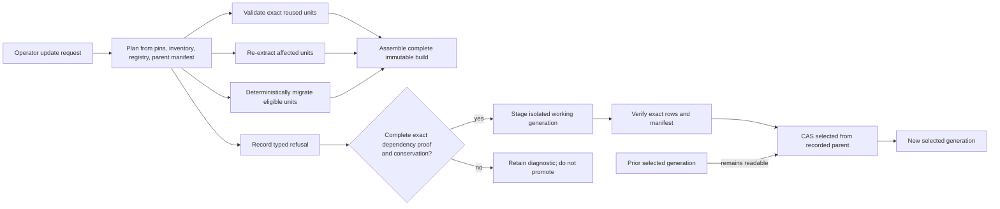
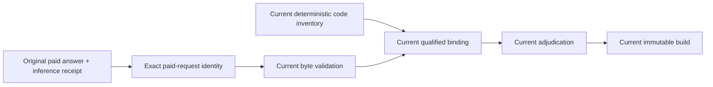

# Delta-updatable estate maps

**BLUF:** A delta update must produce a complete, immutable working generation from a complete build manifest, prove exact input/producer dependency closure and conservation, and only then compare-and-set `selected`. Shadow qualification additionally requires a full deterministic oracle; steady state relies on exact receipts and returns affected closures to shadow whenever their contracts change. Reuse is an optimization of independently validated units—not permission to patch the selected graph. This design adopts per-file/per-extractor units plus explicit repository and global units, preserving the original producer for reused records.



## Decision, scope, and current baseline

This is a public design-only contract grounded in the current producers cited here. Names and fixtures below are invented. No estate bytes, paths, pins, runtime configuration, credentials, or live-state observations belong in this document.

The current command surface distinguishes extraction, merge, claims, and project; project is the command that may build and promote a graph generation. [./bin/ascrybe.mjs:34-45](../bin/ascrybe.mjs#L34-L45) Current extraction reads every routed extractor for each admitted file and writes a scanned manifest with file content identities and extractor availability; it is a full scan rather than a delta planner. [./tools/extract.mjs:158-229](../tools/extract.mjs#L158-L229) Current cache publication already supplies useful fail-closed primitives: an exact producer binding, whole payload validation, a bounded shared lock, staging, and atomic rename. [./tools/extraction-cache.mjs:54-181](../tools/extraction-cache.mjs#L54-L181)

Current serving already isolates a working generation, verifies its complete node and edge manifests before ready, and advances `selected` only through a transactional CAS. [./tools/estate-graph-projection.mjs:1167-1244](../tools/estate-graph-projection.mjs#L1167-L1244) [./tools/estate-graph-projection.mjs:1309-1342](../tools/estate-graph-projection.mjs#L1309-L1342) This design retains that publication model. **Selected-graph in-place patching is rejected:** it cannot demonstrate absence after a delete, makes partially recomputed global joins observable, and loses a single complete artifact for crash recovery and package reproduction.

### Operator command contract and lifecycle

The future CLI owns this operation because it acts on an estate:

```bash
ascrybe update --pin-manifest <estate-pins.json> --parent selected \
  --mode delta|full|shadow --output <external-build-root> \
  --equivalence required|certified --promote
```

`--pin-manifest`, `--mode`, and `--output` are required. `--parent selected` is the default; `--parent-build <build-id>` permits an explicit retained parent and refuses if it is not a valid retained build for the estate. `--mode full` disables **deterministic** unit reuse and recomputes every deterministic extraction/global unit from the same immutable inputs; it reads the declared immutable paid-answer/inference artifacts and never dispatches a model. `delta` requests eligible deterministic reuse, and `shadow` seals a delta candidate but leaves publication to full mode. `--equivalence required` is the default and runs that same-input full deterministic oracle; `certified` permits steady-state delta promotion only when an enabled shadow-qualification receipt covers the unchanged planner, routing, extractor, global-unit, configuration, and runtime dependency closure. `--promote` is explicit; without it the command can only seal/stage a diagnostic or working candidate. `shadow --promote`, `certified` without that enabled closure, `full --equivalence certified`, and `certified` with a changed covered dependency are typed argument refusals. Paid campaign dispatch/reconciliation is a separate custody gate, never an equivalence-oracle side effect. Output is an external immutable build directory, never a mapped repository or the tracked checkout, consistent with the state root custody rule. [./tools/artifact-state.mjs:54-68](../tools/artifact-state.mjs#L54-L68)

The command writes `<output>/estate-build-manifest.json`, reachable unit payloads/receipts, conservation/equivalence receipts, and a projection-run receipt. It exits `0` for sealed/staged/selected success; `2` for typed input, contract, completeness, or equivalence refusal; `3` for CAS conflict (a complete unselected candidate remains retained); and `4` for operational failure before a sealed candidate. A refusal is a durable public reason code plus redacted detail, not a fallback to a different pin or mutable patch.

| Step | Operator-visible state | Required action | Promotion eligibility |
|---|---|---|---|
| Request | `planning` | Supply an exact canonical source pin manifest and choose delta or full mode. | No |
| Plan | `planned` or `refused` | Validate pins, parent manifest, registry, inventory, and leases; enumerate every expected unit. | No |
| Compute | `working` | Reuse, extract, migrate, or refuse each unit in private attempt storage. | No |
| Seal | `complete` or `diagnostic` | Validate receipts, conservation, global inputs, and immutable build digest. | No for diagnostic |
| Equivalence | `equivalent`, `certified`, or `delta_mismatch` | In shadow, run same-input full deterministic mode; in steady state, validate exact dependency receipts, complete manifest, and conservation under an enabled unchanged closure. | Only equivalent/certified |
| Stage | `ready` or `failed` | Stage the full sealed build under an isolated generation and verify exact rows. | Only ready |
| Publish | `selected`, `cas_conflict`, or `rolled_back` | CAS from the recorded parent selected head; retain the old selected generation on conflict. | Only CAS success |
| Retain / collect | `retained` or `collectible` | Apply grace, lease, and reachability checks; then collect unreachable generations and cache objects. | N/A |

The operator may request a full rebuild at any time. Full mode is the fallback, recovery path, and equivalence oracle; a delta mismatch is a fail-closed refusal to promote delta output, not a reason to weaken full mode.

## Immutable contracts

### Identity vocabulary

`observation_id` is a stable logical observation identity. `record_digest` identifies the exact emitted record, including its original producer and byte-level extraction input. A **payload identity** is deliberately distinct from a **current-build membership binding**: the former permits unchanged blobs to survive a repository-tip change; the latter proves where that immutable payload occurs in this build. Neither substitutes for the other.

```text
observation_identity_scope =
  file:       {kind: "file", repository, normalized_path}
  repository: {kind: "repository", repository}
  global:     {kind: "global"}

observation_id = "observation:" + SHA-256(canonical({
  identity_contract, observation_identity_scope, extractor_id,
  observation_kind, producer_local_key
}))

repository_qualified_input_receipt = {repository, role, identity, digest}
input_receipt_digest = SHA-256(canonical(sort(repository_qualified_input_receipts)))

payload_scope =
  file:       {kind, repository, normalized_path, blob_oid, content_sha256}
  repository: {kind, repository, inputs: sort(repository_qualified_input_receipts)}
  global:     {kind, inputs: sort(repository_qualified_input_receipts)}

extractor_contract_dependencies = {
  extractor_id, routing_contract_digest, output_contract, identity_contract,
  implementation_digest, configuration_digest, runtime_digest
}
producer_contract_digest = SHA-256(canonical(extractor_contract_dependencies))
producer_content_digest = SHA-256(canonical(payload_scope))

payload_unit_id = "unit:" + SHA-256(canonical({
  payload_scope, extractor_contract_dependencies
}))

record_digest = SHA-256(canonical({
  output_schema, observation_id, normalized_record,
  producer_contract_digest, producer_content_digest,
  input_receipt_digest
}))
records_digest = SHA-256(canonical(sorted(output.records)))
receipt_digest = SHA-256(canonical(receipt_body_without_receipt_digest))

build_scope_digest = SHA-256(canonical({
  canonical_pins, normalized_inventory, routing_contracts,
  extractor_contracts, configuration_digest, runtime_digest, policy_digest
}))

current_scope_binding =
  file:       {kind, repository, normalized_path, current_source_pin, blob_oid, content_sha256}
  repository: {kind, repository, current_source_pin, inputs: sort(repository_qualified_input_receipts)}
  global:     {kind, pin_manifest_digest, inputs: sort(repository_qualified_input_receipts)}

build_membership_binding = SHA-256(canonical({
  build_scope_digest, payload_unit_id, current_scope_binding
}))

semantic_content_digest = SHA-256(canonical({
  build_scope_digest, sorted_build_membership_bindings,
  observation_record_pairs, global_outputs, claim_outputs,
  projection_content_digest, conservation_result
}))
build_id = "estate-build:" + semantic_content_digest
```

Every `repository_qualified_input_receipt` is `{repository, role, identity, digest}`, where `digest = SHA-256(canonical(identity))`; the sort is canonical over that complete tuple and duplicate tuples are refused. `input_receipt_digest` is always computed from the complete `inputs` array by the formula above—never copied from a parent receipt. `observation_identity_scope` is total and discriminated: file outputs name their repository and `normalized_path`, repository outputs name their repository but no invented path, and global outputs name neither a repository nor a path. Thus no repository/global output is forced through a file-shaped identity. `extractor_contract_dependencies` includes the extractor ID and every versioned routing, implementation, configuration, and runtime dependency.

`build_scope_digest` is fully computable before payload selection or assembly, so no digest depends on itself transitively. `input_receipt_digest` names the complete content-addressed input set for the producing scope, not the parent manifest or current source pin. Therefore a new pin that contains the same repository/path/blob may add a new **file** membership binding without changing that file's `payload_unit_id`, `observation_id`, or `record_digest`; the build manifest proves the current occurrence. Repository and global payloads instead change whenever their declared sorted input set changes. A path change always mints a new observation identity and is represented by deterministic supersession, never by an identity override.

`producer_local_key` is declared by the extractor-kind identity contract. It must be an authored, deterministic key; an output ordinal or line number can locate an exact record but cannot establish continuity. If no unique key exists, the extractor emits an explicit occurrence identity and `identity_continuity: "unavailable"`. It must not guess a match.

A compatible producer may retain `observation_id` while emitting a new `record_digest`. A reused record retains its original `record_digest` and original producer provenance. A new build carries a reuse receipt; it must never rewrite old bytes as if the current producer emitted them. The current projection already treats row identity and record digest as separate verification fields, which is the serving precedent for this distinction. [./tools/estate-graph-projection.mjs:1137-1164](../tools/estate-graph-projection.mjs#L1137-L1164)

### Extraction Unit Receipt v1

An extraction unit is exactly one executable scope plus one extractor contract. Its scope is `file`, `repository`, or `global`; it uses the corresponding `payload_scope` formula above. A file scope has exactly its repository-qualified blob input. A repository scope carries its repository and its complete sorted repository-qualified consumed input receipt array in both `scope.inputs` and `inputs`; a global scope carries that complete array in both places and may not use an implicit “all facts” wildcard. Validators require the two arrays to be canonically equal. `input_receipt_digest` commits to `inputs`, and `unit_id` recomputes from `scope` plus the extractor fields named in `extractor_contract_dependencies`. A scope that cannot enumerate its inputs is refused, not given a synthetic file-shaped ID.

`inputs` is canonical and self-describing. In every example below, `digest` is `SHA-256(canonical(identity))`, `input_receipt_digest` is `SHA-256(canonical(sort(inputs)))`, `producer_contract_digest` and `producer_content_digest` use the preceding formulas, and each displayed `observation_id` is recomputed from the enclosing extractor’s `identity_contract` and `id`, plus the record’s `identity` object. Formula-valued strings show the value a serializer must calculate; they are not accepted literal values. Validators reject a value that does not recompute.

```json
{
  "schema": "estate-map/extraction-unit-receipt/v1",
  "unit_id": "unit:SHA-256(canonical({scope, extractor_contract_dependencies}))",
  "scope": {
    "kind": "file",
    "repository": "amber-ledger",
    "normalized_path": "src/ledger.mjs",
    "blob_oid": "<object-id>",
    "content_sha256": "<64-hex>"
  },
  "extractor": {
    "id": "javascript-declarations",
    "routing_contract_digest": "<64-hex>",
    "output_contract": "javascript-declarations@2",
    "identity_contract": "javascript-declaration-identity@1",
    "implementation_digest": "<64-hex>",
    "configuration_digest": "<64-hex>",
    "runtime_digest": "<64-hex>"
  },
  "inputs": [{"repository": "amber-ledger", "role": "primary", "identity": {"kind": "blob", "normalized_path": "src/ledger.mjs", "blob_oid": "<object-id>", "content_sha256": "<64-hex>"}, "digest": "SHA-256(canonical(identity))"}],
  "input_receipt_digest": "SHA-256(canonical(sort(inputs)))",
  "output": {
    "records": [{"identity": {"observation_identity_scope": {"kind": "file", "repository": "amber-ledger", "normalized_path": "src/ledger.mjs"}, "observation_kind": "symbol", "producer_local_key": "<authored-key>"}, "observation_id": "observation:SHA-256(canonical(identity inputs))", "output_schema": "javascript-declarations@2", "normalized_record": {"name": "LedgerEntry"}, "producer_contract_digest": "SHA-256(canonical(extractor_contract_dependencies))", "producer_content_digest": "SHA-256(canonical(scope))", "record_digest": "SHA-256(canonical({output_schema, observation_id, normalized_record, producer_contract_digest, producer_content_digest, input_receipt_digest}))", "payload_digest": "SHA-256(canonical(normalized_record))"}],
    "kind_counts": {"reference": 3, "symbol": 1},
    "records_digest": "SHA-256(canonical(sorted(output.records)))",
    "complete": true
  },
  "disposition": {"kind": "produced", "source_receipt_digest": null, "compatibility_receipt_digest": null, "migration_receipt_digest": null},
  "receipt_digest": "SHA-256(canonical(receipt_body_without_receipt_digest))"
}
```

Repository and global scopes use the same complete receipt shape, with no implied file fields:

```json
{
  "schema": "estate-map/extraction-unit-receipt/v1",
  "unit_id": "unit:SHA-256(canonical({scope, extractor_contract_dependencies}))",
  "scope": {"kind": "repository", "repository": "amber-ledger", "inputs": [{"repository": "amber-ledger", "role": "consumed", "identity": {"kind": "unit", "unit_id": "unit:<sha256>"}, "digest": "SHA-256(canonical(identity))"}]},
  "extractor": {"id": "repository-index", "routing_contract_digest": "<64-hex>", "output_contract": "repository-index@1", "identity_contract": "repository-index-identity@1", "implementation_digest": "<64-hex>", "configuration_digest": "<64-hex>", "runtime_digest": "<64-hex>"},
  "inputs": [{"repository": "amber-ledger", "role": "consumed", "identity": {"kind": "unit", "unit_id": "unit:<sha256>"}, "digest": "SHA-256(canonical(identity))"}],
  "input_receipt_digest": "SHA-256(canonical(sort(inputs)))",
  "output": {"records": [{"identity": {"observation_identity_scope": {"kind": "repository", "repository": "amber-ledger"}, "observation_kind": "repository-index", "producer_local_key": "<authored-key>"}, "observation_id": "observation:SHA-256(canonical(identity inputs))", "output_schema": "repository-index@1", "normalized_record": {"index": "exports"}, "producer_contract_digest": "SHA-256(canonical(extractor_contract_dependencies))", "producer_content_digest": "SHA-256(canonical(scope))", "record_digest": "SHA-256(canonical({output_schema, observation_id, normalized_record, producer_contract_digest, producer_content_digest, input_receipt_digest}))", "payload_digest": "SHA-256(canonical(normalized_record))"}], "kind_counts": {"repository-index": 1}, "records_digest": "SHA-256(canonical(sorted(output.records)))", "complete": true},
  "disposition": {"kind": "produced", "source_receipt_digest": null, "compatibility_receipt_digest": null, "migration_receipt_digest": null},
  "receipt_digest": "SHA-256(canonical(receipt_body_without_receipt_digest))"
}
```

```json
{
  "schema": "estate-map/extraction-unit-receipt/v1",
  "unit_id": "unit:SHA-256(canonical({scope, extractor_contract_dependencies}))",
  "scope": {"kind": "global", "inputs": [{"repository": "amber-ledger", "role": "consumed", "identity": {"kind": "unit", "unit_id": "unit:<sha256>"}, "digest": "SHA-256(canonical(identity))"}, {"repository": "cobalt-gateway", "role": "consumed", "identity": {"kind": "unit", "unit_id": "unit:<sha256>"}, "digest": "SHA-256(canonical(identity))"}]},
  "extractor": {"id": "estate-resolution", "routing_contract_digest": "<64-hex>", "output_contract": "estate-resolution@1", "identity_contract": "estate-resolution-identity@1", "implementation_digest": "<64-hex>", "configuration_digest": "<64-hex>", "runtime_digest": "<64-hex>"},
  "inputs": [{"repository": "amber-ledger", "role": "consumed", "identity": {"kind": "unit", "unit_id": "unit:<sha256>"}, "digest": "SHA-256(canonical(identity))"}, {"repository": "cobalt-gateway", "role": "consumed", "identity": {"kind": "unit", "unit_id": "unit:<sha256>"}, "digest": "SHA-256(canonical(identity))"}],
  "input_receipt_digest": "SHA-256(canonical(sort(inputs)))",
  "output": {"records": [{"identity": {"observation_identity_scope": {"kind": "global"}, "observation_kind": "resolution", "producer_local_key": "<authored-key>"}, "observation_id": "observation:SHA-256(canonical(identity inputs))", "output_schema": "estate-resolution@1", "normalized_record": {"status": "resolved"}, "producer_contract_digest": "SHA-256(canonical(extractor_contract_dependencies))", "producer_content_digest": "SHA-256(canonical(scope))", "record_digest": "SHA-256(canonical({output_schema, observation_id, normalized_record, producer_contract_digest, producer_content_digest, input_receipt_digest}))", "payload_digest": "SHA-256(canonical(normalized_record))"}], "kind_counts": {"resolution": 1}, "records_digest": "SHA-256(canonical(sorted(output.records)))", "complete": true},
  "disposition": {"kind": "produced", "source_receipt_digest": null, "compatibility_receipt_digest": null, "migration_receipt_digest": null},
  "receipt_digest": "SHA-256(canonical(receipt_body_without_receipt_digest))"
}
```

In all three complete examples, the scope, full repository-qualified inputs, extractor contract, and record identity contain every formula input. Validators recompute `unit_id`, `input_receipt_digest`, each `observation_id`, every `record_digest`, and `receipt_digest`; no synthetic path, repository, or hidden input is permitted.

A file/extractor pair is expected even when it emits zero records; every expected repository/global scope is likewise present even when it emits zero records. The payload receipt intentionally does **not** carry a current pin; the Estate Build Manifest supplies one scope-discriminated `build_membership_binding` per payload occurrence: file bindings name the current repository/path/pin/blob, repository bindings name the repository/pin and complete inputs, and global bindings name the canonical pin manifest and complete repository-qualified inputs. An extractor that emits several kinds has one exhaustive `kind_counts` partition unless its versioned contract explicitly defines independently executable kind subunits. The current registry makes extractor availability and permitted exclusions explicit; delta routing must bind to this complete availability receipt, not assume a module is installed. [./tools/extractors/index.mjs:48-85](../tools/extractors/index.mjs#L48-L85) Parser, grammar/query bytes, redaction policy, configuration, runtime semantics, routing, and availability are all digest-bearing dependencies.

`disposition.kind` is one of:

| Disposition | Meaning |
|---|---|
| `produced` | Current producer ran and emitted this receipt. |
| `reused_exact` | Old bytes and original producer are carried forward after exact receipt/input validation and a compatibility authorization. |
| `migrated` | A deterministic converter emitted the output and names source and migration receipts. |
| `refused` | No usable output exists; a typed reason and affected scope are recorded. |

A cache hit requires receipt self-digest, exact declared scope-input identities, all payload digests, output partition completeness, and the applicable producer contract; reuse additionally requires a new scope-discriminated current-build membership binding. The cache precedent refuses incomplete, binding-mismatched, and payload-mismatched entries rather than accepting a nearby result. [./tools/extraction-cache.mjs:99-124](../tools/extraction-cache.mjs#L99-L124)

### Estate Build Manifest v1

A build manifest is the complete immutable-generation publication input. It is written and fsynced before it receives a content-addressed immutable name; only a sealed manifest may be staged.

```json
{
  "schema": "estate-map/estate-build-manifest/v1",
  "build_id": "estate-build:<semantic-content-sha256>",
  "execution_id": "build-execution:<provenance-sha256>",
  "source": {"pin_manifest_digest": "<64-hex>", "materialization_receipt_digest": "<64-hex>", "pins": {"amber-ledger": "<40-hex>"}},
  "inventory": {
    "files": [{"repository": "amber-ledger", "normalized_path": "src/ledger.mjs", "source_pin": "<40-hex>", "blob_oid": "<object-id>", "content_sha256": "<64-hex>", "routing_digest": "<64-hex>"}],
    "files_digest": "<64-hex>", "deleted_since_parent": [], "renamed_since_parent": []
  },
  "memberships": [{"payload_unit_id": "unit:<sha256>", "current_scope_binding": {"kind": "file", "repository": "amber-ledger", "normalized_path": "src/ledger.mjs", "current_source_pin": "<40-hex>", "blob_oid": "<object-id>", "content_sha256": "<64-hex>"}, "binding_digest": "<64-hex>"}],
  "planner": {"version": "estate-delta-planner@1", "producer_registry_digest": "<64-hex>", "configuration_digest": "<64-hex>", "runtime_digest": "<64-hex>", "parent_build_id": "estate-build:<sha256>"},
  "units": {"expected": ["unit:<sha256>"], "produced": [], "reused_exact": [], "migrated": [], "refused": [], "receipts_digest": "<64-hex>"},
  "records": {"observation_ids_digest": "<64-hex>", "observation_record_pairs_digest": "<64-hex>", "kind_counts": {"symbol": 1}},
  "downstream": {"global_unit_receipts": ["<64-hex>"], "campaign_receipt_digest": "<64-hex>", "projection_input_digest": "<64-hex>"},
  "completeness": {"status": "complete", "conservation_receipt_digest": "<64-hex>"},
  "semantic_content_digest": "<64-hex>",
  "execution_provenance_digest": "<64-hex>",
  "manifest_digest": "<64-hex>"
}
```

The inventory names all in-scope files, each expected routed unit, every zero-output result, scope exclusion, delete, rename candidate, repository unit, and global unit. `units.expected` is the exhaustive union of scope-discriminated file, repository, and global `payload_unit_id`s; each has exactly one receipt/disposition and one scope-discriminated membership. A deleted path has no current file unit and its parent units are explicitly retired. `semantic_content_digest` covers canonical source/scope identity, observation-ID/record-digest multiset, global/claim/projection semantic outputs, and conservation result; `build_id` names that semantic content. `execution_provenance_digest` covers unit dispositions, original/reuse/migration receipts, attempts, and other execution custody; `execution_id` names that immutable execution record. Thus a full and delta execution may have different provenance and manifest digests yet must have equal semantic content and projection identity. Both manifests must independently validate. A manifest with a missing/corrupt receipt, an undeclared payload, a nonterminal expected unit, incomplete global inputs, or a non-complete conservation result is diagnostic-only and cannot be projection input.

## Extractor evolution, deletes, and global work

| Change class | Definition | Required result |
|---|---|---|
| Compatible | Same meanings, kind set, completeness, schemas, and identity function for prior inputs. | Phase 1 re-extracts every unit routed to a changed extractor implementation/contract; unaffected extractors may reuse. Cross-version output reuse is deferred unless a deterministic migration or an exact current-scope dual-run proves every finite routed input-unit digest and complete global closure. The proof receipt names that exact set, old/new outputs and identities, and verifier digest. Human assertion, representative corpus, and sampling are not authority. Preserve original producer whenever a proved reuse occurs. |
| Additive | Existing meanings remain compatible; optional kinds or fields are added. | Preserve old partitions; run every newly applicable subunit. Rerun the complete file/extractor unit if its contract does not isolate subunits. |
| Breaking | Changed semantics, routing, removal behavior, identity function, required field, parser interpretation, or completeness. | Re-extract affected units, or deterministically migrate them. Refuse if bytes are unavailable, conversion is partial, or mapping is ambiguous. |

A migration receipt includes converter ID and implementation digest, source and output schema/digests, total identity mapping, supersessions, and typed refusals. It must be deterministic, rerunnable, and total over the admitted input. A converter may retain an `observation_id` only when the target independently evaluates the same identity contract, repository, path, extractor, kind, and producer-local key; it otherwise mints a new identity and explicitly supersedes the prior one. A migration must never override the published `observation_id` formula.

A rename is always delete-plus-add because `normalized_path` is part of `observation_id`. An optional kind-specific rename matcher over verified old/new blob identities and keys may emit a deterministic, one-to-one `supersedes` receipt from the old observation to the new observation; it never preserves either `observation_id`. Ambiguous, partial, or non-total rename matching is refused. A delete removes all current records from the complete set and invalidates global units that consume them. A routing change that adds an extractor creates an expected unit; its absence blocks completeness.

Repository and global units model multi-file work: repository indexes, cross-file joins, duplicate/ambiguity analysis, and estate-wide resolution. They declare a complete sorted input unit/record-digest set and join configuration. Any changed consumed record, deletion, or changed ambiguity set invalidates the dependent global unit. This is required because current extraction invokes every matching extractor per file and one extractor may emit multiple kinds; file locality does not make downstream joins local. [./tools/extract.mjs:180-192](../tools/extract.mjs#L180-L192)

## Delta planner, publication, recovery, and collection

1. Acquire a short planning lease keyed by estate and recorded parent build. Validate canonical pins/materialization and enumerate normalized repository-qualified blob identities.
2. Diff the parent inventory into added, unchanged, modified, deleted, and advisory rename candidates. Resolve current routing and construct the exhaustive expected unit set.
3. Independently and in parallel where safe, validate exact reuse, execute affected extraction, or run deterministic migration in a unique attempt directory. On cache corruption, quarantine the object by digest and recompute; never edit it in place or fall back to a similar key.
4. Recompute every dependent repository/global unit. Assemble all admissible outputs into a complete record set; validate identity uniqueness, partitions, retirements, migration mappings, and conservation.
5. Fsync immutable payloads and manifest, atomically publish the sealed build by content address, then construct a **complete** projection from it in an isolated working generation. No working or selected head may refer to an unsealed filesystem build.
6. Verify the generation against the sealed manifest. In shadow, run full deterministic equivalence; in steady state, validate the exact dependency closure, every receipt, and conservation under the enabled qualification receipt. CAS `selected` from the recorded parent only if the applicable gate passes. A conflict retains a verified candidate for later comparison or collection; it never merges graph rows.
7. GC after a grace period and a second root/lease snapshot. Roots include selected, working, retained superseded generations, active attempts and leases, packages, and pinned audit/reproducibility artifacts.

| Case | Required recovery behavior |
|---|---|
| Crash before unit seal | Ignore incomplete attempt; collect after grace. |
| Crash after unit seal, before manifest | Reuse only after complete validation. |
| Crash after build seal, before stage | Resume from sealed build. |
| Crash during stage | Selected is unaffected; discard/recreate attempt namespace, or resume only after verifying every written batch against the sealed manifest. |
| Crash after ready, before CAS | Retry CAS against recorded expected selected head. |
| Concurrent planners | Per-key lease/create prevents conflicting writers; deterministic duplicate computation may converge; selected CAS chooses one complete generation. |
| Lease expiry / stalled owner | A new owner may reclaim only after expiry plus owner/fencing-token verification; it must not delete live attempt data before the grace rule. |
| Cache corruption | Record `cache_corrupt`, quarantine, recompute, and block reuse. |
| GC race | Mark from a consistent head/lease snapshot; sweep only after grace and a second absence check. |

Existing projection retention already protects selected/working heads, scopes candidates by estate, and deletes old generations in bounded batches. [./tools/estate-graph-projection.mjs:1253-1305](../tools/estate-graph-projection.mjs#L1253-L1305) Delta cache collection must provide the same reachability protection for sealed build artifacts and leases.

## Paid answer reuse and documentary campaigns

Paid answer reuse is separate from current deterministic binding. Reuse only the exact model answer bytes and original inference receipt when the repository/path, document blob identity, window boundaries/bytes, and versioned `paid_request_identity` match. **Repository tip, pin-set identity, and current-build membership are excluded from paid-request identity** only when the rendered prompt does not contain them; the current build/revalidation receipt binds a reusable answer to the new pin. If a prompt renders a pin, it becomes a required paid input and invalidates reuse. Always run current deterministic validation, obligation selection, adjudication, claim-map composition, global joins, and projection binding from current inputs. An old bound claim is not current merely because its paid answer is reusable.



`paid_request_identity/v1` includes repository/path, document blob identity, exact window bytes/boundaries, rendered prompt digest/template, model/provider/route/reasoning, extractor contract, and custody policy—not the source pin unless the rendered prompt includes it. The current prompt is constructed from the window outline and numbered window content; `outline(window)` renders `DOCUMENT ${window.path}`, so the path is both rendered and a required paid-reuse dependency. [./tools/semantic-claim-extractor.mjs:211-224](../tools/semantic-claim-extractor.mjs#L211-L224) It deliberately excludes code inventory only while the rendered prompt does not include it. If a future prompt includes a pin, code facts, symbol menus, checks, or any inventory-derived input, that exact dependency becomes a paid input and reuse across its change is refused. The current checkpoint journal is a useful fsynced fingerprinted baseline, but its first-write-wins key/value shape and torn-tail behavior are insufficient for paid dispatch custody; the campaign requires immutable `prepared`, `dispatched`, and terminal transitions. [./tools/checkpoint-journal.mjs:8-75](../tools/checkpoint-journal.mjs#L8-L75)

The landed [Multi-repository documentary campaigns](multi-repository-documentary-campaigns.md) design takes precedence for canonical pin manifests, repository-qualified source addresses, paid-call transition custody, partial campaign refusal, composite source vocabulary, and later live acceptance. Delta work follows that contract:

- Its canonical pin manifest and materialization receipt are the build manifest source root.
- Its pin-bearing campaign/window identity remains repository-qualified and byte-exact; `paid_request_identity/v1` is a separately versioned answer-byte identity, never a checkpoint or binding identity.
- A changed pin refuses direct checkpoint replay. Cross-pin reuse is possible only when the campaign's new immutable `prepared` then `imported_completed` transition proves an exact paid-request match and names the prior completed-call/inference receipt digest; it performs no provider dispatch.
- The unit disposition carries the original inference receipt, the immutable import receipt where applicable, and a current revalidation/binding receipt, preserving original model producer identity without restamping the old checkpoint.
- Every claim map, remap output, build manifest, and projection agrees on the same explicit current pin set and manifest digest.
- Packages include the reachable manifest and unit/reuse/import/migration/campaign receipts; verification walks their digest closure before reproduction.
- Zero or multiple qualified deterministic bindings remain refusal/underdetermined; no cross-repository fallback is permitted.

This preserves the campaign design’s complete source accounting: a refused or absent source/window is explicit and prevents a complete promotion unless the declared scoped contract permits it. [./docs/multi-repository-documentary-campaigns.md:120-179](multi-repository-documentary-campaigns.md#L120-L179) Its external live-session boundary also remains unchanged. [./docs/multi-repository-documentary-campaigns.md:322-341](multi-repository-documentary-campaigns.md#L322-L341)

## Equivalence, conservation, observability, and rollout

There are two explicit phases.

1. **Shadow qualification:** every delta candidate is paired with full deterministic mode from the same immutable source and paid-answer artifacts; it never re-dispatches a model. The delta and full manifests must each validate, then have equal `semantic_content_digest`, observation-ID/record-digest multiset, every global-unit output, claim/binding/adjudication output, projection content digest, and projection ID. They are not required to have equal dispositions, receipts, attempts, `execution_provenance_digest`, or `manifest_digest`.
2. **Steady state:** an unchanged qualified planner/routing/extractor/global-unit/configuration/runtime dependency closure may promote from exact payload and current-membership receipts, complete-manifest validation, global-input validation, and the conservation identities. Changed extractor units re-extract by default. Any planner, routing, extractor, global dependency, configuration, runtime, or policy change returns its affected closure to shadow/full-oracle mode.

Steady state is the deterministic update-time benefit: it relies on the declared dependency graph being complete and on exact input/producer matching, not on a claim that a sample proves all future inputs. This is its trust boundary. Scheduled full rebuilds and sampled comparisons are telemetry wards that can expose a missed dependency, but are never promotion authority. A mismatch is `DELTA_FULL_MISMATCH`: retain diagnostic receipts, disable the affected qualification closure, block subsequent steady-state promotion there, and use shadow/full mode after investigation. Existing staging verifies exact node/edge ID-and-digest manifests and rejects early or extra rows; delta extends rather than replaces that gate. [./tools/estate-graph-projection.mjs:1137-1164](../tools/estate-graph-projection.mjs#L1137-L1164)

All terms below are disjoint sets keyed by their exact identity.

```text
requested_repositories = materialized_repositories ⊎ refused_repositories
inventoried_paths = added_paths ⊎ unchanged_paths ⊎ modified_paths ⊎ renamed_target_paths
parent_paths = unchanged_paths ⊎ modified_paths ⊎ deleted_paths ⊎ renamed_source_paths
expected_units = produced_units ⊎ reused_units ⊎ migrated_units ⊎ refused_units
routed_file_extractor_pairs = expected_file_units
unit_output_records = ⊎ kind_partition_records
build_records = ⊎ output_records(admissible expected units)
|build observation IDs| = |unique build observation IDs|
parent_records - retired_or_superseded_records + added_or_changed_records = candidate_build_records
paid_windows = completed_new ⊎ replayed_same_window ⊎ imported_completed ⊎ pre_dispatch_refused ⊎ failed_known ⊎ accepted_unknown
proposals = admitted_claims ⊎ refused_proposals
admitted_claims = terminal_adjudication_receipts
verified_generation_nodes = manifest_node_identities
verified_generation_edges = manifest_edge_identities
reachable_cache_objects ⊎ collectible_cache_objects = all_cache_objects
reachable_cache_objects ∩ collectible_cache_objects = ∅
```

| Falsifier (invented inputs) | Required outcome |
|---|---|
| Change one byte in `amber-ledger/src/ledger.mjs`. | Only routed/dependent units invalidate; unchanged receipts retain original provenance. |
| Add then delete `cobalt-gateway/src/obsolete.mjs`. | Current build contains no retired record; dependent global units rerun. |
| Rename identical bytes. | Delete/add identity by default; continuity only with verified rename migration. |
| Change extractor bytes without changing a version label. | Implementation digest moves; reuse requires proven compatibility or re-extraction. |
| Add a second matching extractor. | Expected unit set grows; missing output blocks completeness. |
| Change one multi-kind output schema. | Reuse only independently complete declared subunits; otherwise rerun the full unit. |
| Delete a fact that made a cross-file join unique. | Global join reruns and may refuse/underdetermine; stale resolution cannot survive. |
| Truncate/add/edit cache payload or receipt. | Validation fails closed, object is quarantined, and computation reruns. |
| Race two updates from one parent. | At most one selected CAS succeeds; readers see old or one complete winner, never a mix. |
| Crash halfway through staging. | Partial generation never becomes ready/selected. |
| Change code only, leaving exact paid prompt bytes. | Direct checkpoint replay is refused at the new pin; only a verified `imported_completed` campaign transition may reuse the original answer bytes, and current validation/binding/adjudication rerun. |
| Add code inventory to prompt. | `paid_request_identity` moves; direct replay and cross-campaign import across the code change are refused. |
| Run collection while a package or working build holds a lease. | Reachable/leased artifacts survive; only twice-confirmed unreachable items past grace are collected. |

Telemetry records planner reason counts (reuse/extract/migrate/refuse), per-extractor and global invalidation fan-out, cache validation/corruption, lease waits/reclaims, bytes and unit counts, full/delta equality result, stage/CAS/conflict latency, selected age, retention/GC candidates and deletions, and paid answer reuse versus rebinding results. It contains identifiers and aggregate reason codes, never source bytes, unredacted paths, credentials, or model prompts.

Roll out behind opt-in shadow mode: (1) full deterministic mode remains publication owner while delta seals and compares against the same immutable paid artifacts; (2) qualify an unchanged planner/routing/extractor/global dependency closure with shadow evidence; (3) promote steady-state delta only while that closure and every exact receipt match; (4) return affected closures to shadow on contract/dependency change; (5) use sampling only as telemetry; (6) retain full fallback and the previous selected generation. Roll back by disabling delta planning, invalidating the affected qualification closure, selecting the retained prior complete generation through normal CAS, and preserving receipts for diagnosis. Never roll back by mutating selected rows.

## Extractor-update survival guarantee and limits

A selected generation survives an extractor update: it remains readable until a new complete, equivalent generation CAS-promotes, and retained generations remain rollback candidates under retention policy. A compatible/additive update may preserve logical observation IDs and original producer provenance for carried-forward records. A breaking update may preserve identities only through a proved deterministic migration; otherwise it supersedes them or refuses.

This design **cannot guarantee** identity continuity where an extractor lacks a deterministic authored key, semantic equivalence where a new parser changes interpretation, reuse where old inputs or receipts are missing/corrupt, or recovery of collected generations. It cannot guarantee paid answer reuse after a paid-input change or provider uncertainty. It never trades these limits for guessed mappings, stale bindings, partial publication, or mutable selected-graph repair.

## Delivery boundaries

| Unit | WHO / WHERE / WHEN boundary | Work |
|---|---|---|
| Public implementation | One Ascrybe implementer, one repository worktree, sequential stages. | Registry, schemas, planner/cache, migrations, global units, paid-answer split, package/query/projection integration, invented fixtures, and public docs stay together: splitting changes neither who, where, nor when. |
| Proof and review | Proof runner/reviewer in an isolated proof environment, after implementation. | Full declared battery, equivalence and failure falsifiers, public-data scan, independent review. |
| Live acceptance | Authorized session owner with machine-local estate/model/Neo4j custody, after landing. | Pins, paid campaign, opaque witnesses, live promotion/query/package checks, measured cost. |

The implementation unit must be sized to its worker’s context capacity. If the complete same-worker work cannot be reasoned about safely in one context, divide only at a genuine handoff boundary—for example an independent proof environment or the later private live domain—not into conceptual stages that share one repository, worker, and sequential timing. The repository’s contributor boundary requires such private/live work to run outside a Batch worktree. [./CONTRIBUTING.md:47-51](../CONTRIBUTING.md#L47-L51)
