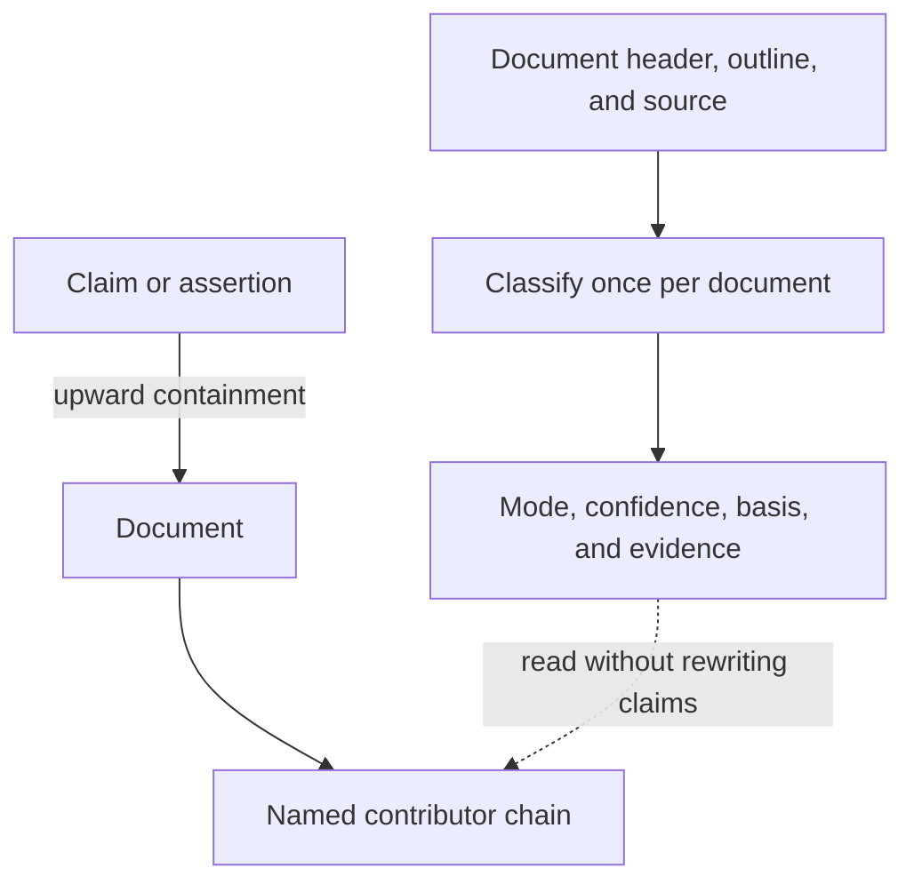

# Document standing: classify once, compose at read time

Document standing belongs to the document; a claim's local wording does not independently establish its container's authority. Classification and query-time composition must remain separate.

## Why window-local status is insufficient

A source window can correctly quote a heading while missing the document's explanation of that heading. In an invented Parcel dossier, a header might declare the document ratified while a section keeps the historical title `Proposed routing`. A local extractor must not silently turn that title into a document-wide authority decision.

Keep three questions distinct: what the text asserts, what the document declares about itself, and which contributors matter to the reader's question. Expose disagreements rather than replacing them with an unexplained effective score.

## Classification and composition

| Concern | Classification | Composition |
| --- | --- | --- |
| Unit | One document | One query |
| Input | Header, outline, and relevant source | Existing records and containment edges |
| Output | Mode, basis, evidence, and any confidence | Named contributor chain |
| Update | New classification record | Recompute the query |
| Claim mutation | None | None |

`tools/document-mode.mjs` supplies deterministic declarations, path conventions, structural matches, and explicit unclassified outcomes. A semantic classifier with a distinct `read` basis is a proposal, not authorization for a paid run or a claim that provider integration is complete. Its verdict must preserve evidence and confidence rather than masquerading as an observed source property.

## Traverse upward, not through the estate

Justification and containment answer different questions. Justification follows evidential relations; admitting undirected containment would walk into sibling claims and potentially the whole graph. Ancestry therefore follows structural relations only toward their registry-declared parent end.

Use directed expansion, bounded frontier and parent counts, and explicit omission reporting. `Project` and `SourceCommit` are ambient anchors: report them as the top of a chain, but do not expand through everything they contain. Use the established `{relation, edge_id, from, to}` edge shape so evidence filtering can remove excluded endpoints consistently.

## Preserve provenance

A projection is immutable and digest-identified. Copying a changing classification onto every claim would require a new projection whenever the classifier changes and would hide which document supplied the classification. Compose standing from its document at read time; an unavailable classification stays an explicit absence.

The answer is question-dependent. A query about current specifications may exclude archived research; a query about abandoned decisions may require it. Return the named contributors and their declared standing instead of committing one interpretation for every future question.

## Proposed classifier interface

A future document-level classifier takes the document path, bounded header, heading outline, and deterministic classification. It returns document identity and source pin, mode, adjudication frame, archive status, basis, confidence, exact evidence locations, and disagreements with deterministic bases.

| Basis | Witness | Reporting precedence |
| --- | --- | --- |
| `declared` | Front matter | 1 |
| `read` | Header prose with confidence | 2 |
| `structure` | Headings | 3 |
| `path` | Repository convention | 4 |

Precedence orders reports; it never deletes disagreement. Low confidence remains visible rather than being thresholded into silence. Evidence must be verbatim and re-findable; unavailable evidence is a refusal. `unclassified` remains an admissible outcome. Missing standing is `null`, never a guessed mode.

The proposed classifier must retain replayable journals bound to the exact source bytes. Public evaluation uses invented fixtures or Ascrybe's own public source, not private corpus measurements. The upward walk caps the frontier and parents per node at eight each and keeps ancestry separate from evidential justification. These bounds must not be confused with a qualification against a private estate.
