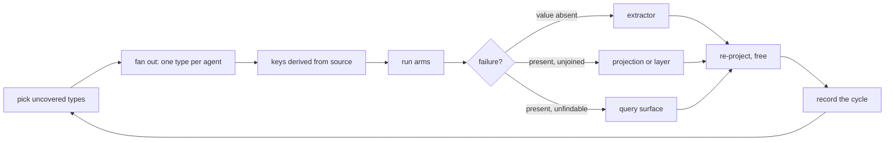

# The improvement loop

**Opinion: a question the map cannot answer is worth more than one it can, because only the failure
names a surface to fix.** This document encodes the loop so a cycle diagnoses rather than
rediscovers. It optimises one thing: the completeness and correctness of projected data. Every
surface between reading a file and answering a query is in scope.

## Why the loop exists rather than a checklist

A query can read the wrong view, a projection can discard unregistered fact kinds, and an
extractor can miss nested values. Fixing one layer may expose a different defect beneath it.
Re-measure the end-to-end result instead of treating the first green checkpoint as completion.

## Question types, and the capability each requires

A question type is not a subject. It is a shape whose failure indicts something specific.

| Type | The question | Requires |
|---|---|---|
| **Value lookup** | what does this declaration evaluate to | literal facts, recursively, with per-leaf lines |
| **Assertion vs reality** | a document states a value the code contradicts | both planes, plus a join |
| **Producer / consumer** | what one side sends vs what the other expects | cross-repo binding of shapes |
| **Reach** | who calls, declares, or depends on this | cross-repo identity resolution |
| **Was it done** | a decision was recorded — did it land, get undone, get superseded | supersession, decision status |
| **Unpaired** | declared and never used; consumed and never produced | closed inventories on both sides |
| **Which copy is live** | duplicated artefacts, one authoritative | provenance, not similarity |
| **Bounded absence** | is there any X at all | an explicitly complete inventory |

Coverage is measured over **types**, not over questions. A type with no incarnation in the suite is
an untested capability, and should be recorded as such rather than left silent.

## Fan-out rules

Each rule below was bought by a cycle that violated it.

1. **One type per agent.** Agents briefed by role converge: two independently produced the same
   finding, which is duplicated spend that measures nothing extra.
2. **No agent may lean on one artefact repeatedly.** Four questions in one batch all rested on a
   single stale registry file. That inflates a score while testing one insight.
3. **Keys are derived from source, never from the map.** A key built by querying the graph makes
   the graph agree with itself, and the graph-arm wins by construction. Keys carry path, line,
   verbatim quote and blob digest.
4. **Every candidate carries a disqualification note** — the strongest argument against itself.
   Rejecting a question costs nothing before a run and everything after.
5. **Agents are told nothing about the map.** No node kinds, no relations, no mention that a graph
   exists. A question shaped by the ontology can only find gaps inside it.
6. **A question a single grep answers is rejected.** It must need cross-repository reach, or both
   the documentary and code planes.

## Failure to surface

The diagnosis, not the score, is the output of a run.

| Symptom | Surface | Fix shape |
|---|---|---|
| The value was never extracted | **extractor** | recurse, bound depth, attribute every leaf |
| Extracted, absent from the graph | **projection** | declare the kind; count what no kind declares |
| Present on both sides, not connected | **layer** | derived edge, recomputed free, refutable |
| Present and correct, not retrievable | **query surface** | ranking, addressing, result shape |
| Retrieved but unreadable | **presentation** | what a person orients by comes first |

**Truncation is not a fix, and check which axis a bound is on.** A cap that silently shortens is
the same defect one layer down. Worse, a bound can be measured on the wrong dimension entirely: a
recursion-depth limit was added to bound extractor output, but an AST is finite and acyclic so
nothing needed bounding for termination, and output size is width TIMES depth. The limit refused a
one-branch chain forty levels deep, costing forty values, while admitting a 128-wide object three
deep, costing two million. Bound the thing that actually grows, and name whatever the bound drops.

## Invariants a cycle must not break

- **Every absence is counted and named.** A fact skipped without a tally is indistinguishable from a
  fact nobody produced. This is the defect that recurs at every layer; assume it is present.
- **State the number before measuring it.** A metric read afterwards accommodates whatever it finds.
- **A derived conclusion stays refutable.** A layer that asserts a contradiction must record why it
  fired, or it mints a new population of unfalsifiable claims.
- **Re-projection is free; re-extraction is not.** Prompt-affecting changes invalidate the journal
  and must be batched before a paid run. Everything downstream replays at no cost.

## Per-cycle record

Written each cycle so a later one can tell a new gap from a regression:

- projection id, and the counts by node kind
- `unregistered_fact_kinds` — extracted, carried, and declared by nothing
- which types were exercised, which were not, and why
- for every failed question: the surface indicted and the evidence
- the fix, and the number that would show it worked, stated before it was measured

A cycle that produces no failure has either exhausted its types or asked questions shaped by the
map. The second is the more likely, and the recorded types are how it is caught.
