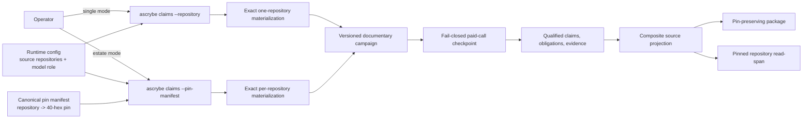
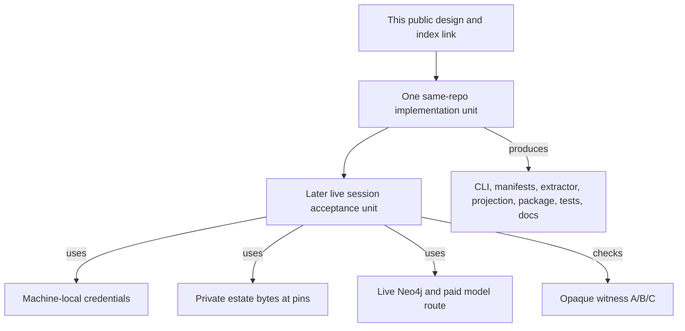

# Multi-repository documentary campaigns

**BLUF:** Adopt Option B: one documentary campaign over one validated, canonical pin manifest. It completes the latent multi-repository branch without treating a pin-map digest as a Git commit, makes every documentary and code address repository-qualified, and makes **direct checkpoint replay** fail closed. A separately versioned paid-answer import may reuse answer bytes across campaigns only after exact paid-input proof, immutable completed-call custody, and current pin-bound validation. This is a design only; implementation and the later paid acceptance run are distinct units. [Delta-updatable estate maps](delta-updatable-estate-maps.md) is the prerequisite update/publication design; this document takes precedence for campaign pins, qualified source custody, and paid-call custody.



## Decision and current boundary

Option B is the only selected option. One campaign has one normalized source set, one window
ledger, one claim/evidence map, and one projection identity; it avoids post-hoc composition
(Option A) and a separately headed documentary overlay (Option C). The gathered investigation is
a lead, not authority; the current producer reads below establish the design baseline.

| Current producer or consumer | Current behavior | Gap the design closes |
|---|---|---|
| CLI dispatcher | `claims` invokes `tools/semantic-map-run.mjs`, but unlike config-bearing estate verbs it does not inject `--runtime-config`. | Estate membership never reaches the command. [./bin/ascrybe.mjs:27-45](../bin/ascrybe.mjs#L27-L45) |
| Claims parser | Accepts one `--repository`; it exposes no estate/pin-manifest mode. | The exported `repositories` capability is unreachable. [./tools/semantic-map-run.mjs:289-303](../tools/semantic-map-run.mjs#L289-L303) |
| Claims runner | Already accepts `repositories`, materializes named roots, and derives the ordered-pin digest. | It ad hoc reads configuration pins, has no canonical manifest input or repository refusal ledger. [./tools/semantic-map-run.mjs:83-134](../tools/semantic-map-run.mjs#L83-L134) |
| Materializer | Produces `estate-pins/v1`, removes partial output after a member failure, records per-member refusals, and derives a pin-map digest. | The paid producer must consume this same artifact rather than reconstruct its meaning. [./tools/materialize-estate.mjs:52-121](../tools/materialize-estate.mjs#L52-L121) |
| Semantic extractor | Keys journal reuse only by prompt digest and skips malformed JSON lines. | Paid replay lacks campaign/call identity and non-tail corruption refusal. [./tools/semantic-claim-extractor.mjs:368-374](../tools/semantic-claim-extractor.mjs#L368-L374) |
| Claim producer | Emits path-only documentary sources and path-only symbol obligations. | Equal names and relative paths can be conflated across repositories. [./tools/semantic-claim-extractor.mjs:245-274](../tools/semantic-claim-extractor.mjs#L245-L274) |
| Projection/query/package | The projection uses `SourceCommit` for every source identity; query selects a repository pin but returns the estate digest; packaging reads pins from a receipt that does not emit them. | Composite provenance is mislabeled or lost. [./tools/estate-graph-projection.mjs:481-508](../tools/estate-graph-projection.mjs#L481-L508), [./tools/estate-graph-query.mjs:564-607](../tools/estate-graph-query.mjs#L564-L607), [./tools/project-estate-map.mjs:89-113](../tools/project-estate-map.mjs#L89-L113), [./tools/projection-package.mjs:110-130](../tools/projection-package.mjs#L110-L130) |

The existing checkpoint journal is the custody primitive to reuse: it fingerprints a declared
context, fsyncs each entry, admits only a torn final line, and rejects a corrupt complete line or
fingerprint mismatch. [./tools/checkpoint-journal.mjs:8-75](../tools/checkpoint-journal.mjs#L8-L75)

## Command contract

`ascrybe claims` becomes config-bearing, using the dispatcher’s existing runtime-config resolution
precedence. The claims parser owns the mutually exclusive selection below; no positional fallback,
implicit “digest looks like a commit” mode, or mixed mode exists.

| Mode | Invocation shape | Required input | Refuse |
|---|---|---|---|
| Single repository | `ascrybe claims --repository <repo> --config <campaign-config> --output-dir <dir>` | One 40-hex `sha` in campaign config and documentary paths local to that repository | `--pin-manifest`, a 64-hex `sha`, or repository-qualified source objects |
| Estate | `ascrybe claims --pin-manifest <estate-pins.json> --config <campaign-config> --output-dir <dir>` | Runtime `source_repositories`, canonical manifest, and repository-qualified documentary sources | `--repository`, a 40-hex `sha`, legacy string documentary paths, a manifest/config membership mismatch, or any bare source address |

The dispatcher marks `claims` as `config: true`; an explicit `--runtime-config` remains authoritative,
otherwise existing config resolution supplies it. The estate parser reads the runtime membership only
to locate declared repositories, then validates the manifest before any materialization. It never
accepts an arbitrary `--repositories` JSON map. A single-run compatibility adapter may translate a
legacy string path to `{ repository: project_id, path }` at process ingress, but every durable
record uses the structured form.

## Canonical source set and materialization

### Pin-manifest v2

A canonical `estate-map/estate-pin-manifest/v2` is the immutable campaign input. It contains every
runtime-declared member’s **requested** 40-hex pin, code-point sorted by `repository`, and is
self-digested over its body excluding the digest. Materialization writes a distinct
`estate-map/estate-materialization-receipt/v2` that references that manifest and gives every
requested member one terminal disposition:

```json
{
  "schema": "estate-map/estate-pin-manifest/v2",
  "pins": {
    "amber-ledger": "<40-hex>",
    "cobalt-gateway": "<40-hex>"
  },
  "pin_manifest_digest": "<64-hex>"
}
```

```json
{
  "schema": "estate-map/estate-materialization-receipt/v2",
  "pin_manifest_digest": "<64-hex>",
  "members": [
    { "repository": "amber-ledger", "requested_pin": "<40-hex>", "state": "materialized" },
    { "repository": "cobalt-gateway", "requested_pin": "<40-hex>", "state": "refused", "refusal": { "code": "GIT_TREE_ENTRY_UNSUPPORTED", "public_detail": "unsupported tree entry" } }
  ],
  "materialized_source_identity": "<64-hex ordered successful-pin digest>",
  "receipt_digest": "<64-hex>"
}
```

A refusal retains its `requested_pin`; it is never inferred or omitted. `public_detail` is a bounded,
redacted diagnostic class, not a raw Git error. Raw errors and absolute local paths stay in a
machine-local diagnostic log, are excluded from identities and packages, and never enter a portable
receipt. A valid estate campaign requires matching runtime membership, a valid pin manifest and
receipt, and at least one materialized member. Each materialized exact-tree manifest carries its
repository, requested 40-hex pin, tree, object format, blob list, and bytes digests. Mixed Git
object formats remain refused, consistent with the latent branch’s exact-manifest restriction.
[./tools/semantic-map-run.mjs:113-134](../tools/semantic-map-run.mjs#L113-L134)

The identities are predeclared:

```text
materialized_repositories ∩ refused_repositories = ∅
declared_repositories = materialized_repositories ∪ refused_repositories
pin_manifest_digest = SHA-256(canonical(requested {repository: pin}))
materialized_source_identity = SHA-256(canonical({repository: requested_pin} for materialized repositories))
receipt_digest = SHA-256(canonical(receipt body without receipt_digest))
```

The materializer consumes **only** already declared pins, never current heads. It validates each
exact tree, then writes the receipt atomically after all members reach `materialized` or `refused`.
Per-member failure deletes that member’s target before recording its refusal; no files outside
`materialized_repositories` can enter extraction. This retains the current partial-tree protection.
[./tools/materialize-estate.mjs:83-98](../tools/materialize-estate.mjs#L83-L98)

The manifest and receipt are revalidated before extract, claim evidence, project, package, and
read-span. A missing repository, changed membership, unknown member, pin mismatch, invalid digest,
or source tree that cannot reproduce its entry is a typed refusal; no fallback to a working tree or
a different revision is permitted. A v1 manifest is historical/inspection input only; it can become
a v2 campaign input only when an operator independently supplies and validates every requested pin,
because current v1 records a pin only after successful materialization. [./tools/materialize-estate.mjs:76-85](../tools/materialize-estate.mjs#L76-L85)

### Documentary address and source custody

Every document source is mandatory structured identity:

```json
{
  "repository": "amber-ledger",
  "path": "design/ledger-contract.md",
  "pin": "<40-hex>",
  "blob_oid": "<git blob oid>",
  "content_sha256": "<64-hex>"
}
```

`repository` is a simple declared member name; `path` is a normalized, relative path within that
repository, never the materialization prefix. `{repository, path}` is the **logical locator**. Its
pinned source identity is `(repository, path, pin, blob_oid, content_sha256)`. Every durable
claim, evidence, receipt, shard, package, and read response carries the logical locator and, when
it attests bytes, the full pinned source identity. A window additionally includes start/end lines,
start/end byte offsets, and `window_bytes_sha256`. Thus physical materialization may use
`<estate-root>/<repository>/<path>` without that layout becoming an identity convention.

A manifest member refused during materialization cannot offer documents. Each configured source in
that member produces a `DOCUMENTARY_SOURCE_REPOSITORY_REFUSED` refusal; each source absent from its
pinned tree produces `DOCUMENTARY_SOURCE_ABSENT_AT_PIN`. A document offered to the model must have
one materialized member and an exact manifest entry. No source is silently omitted.

## Claims, obligations, and evidence

### Qualified end-to-end records

The campaign config’s estate form is `documentary_sources: [{repository, path}]`; `documentary_paths`
is single-mode-only. Claims, claim keys, evidence, and obligations carry the source address above.
A claim key begins with the repository and source path, not a joined display string. Claim IDs remain
content-derived but hash the structured source object, so two documents at the same path in different
repositories never collide.

Code addresses are equally qualified:

```json
{
  "repository": "cobalt-gateway",
  "path": "src/entry.mjs",
  "line": 41,
  "symbol": "publishReceipt",
  "declaration_kind": "function",
  "exact_record_digest": "<64-hex>"
}
```

Estate-mode generated `code_symbol_declared` obligations carry a logical selector
`{repository, path, symbol, declaration_kind}` and the chosen evidence identity
`{line, exact_record_digest, fact_id}`. All fields are mandatory. The deterministic selection rule
is closed: a bare symbol or relative path in a documentary source searches only that source’s
`repository`; a cross-repository target is eligible only if the source text contains an exact,
parseable `{repository, path}` locator, which scopes its symbols and tree/text obligations to that
named repository. Zero or multiple candidates after this scope produce `open_question` during
binding (or `underdetermined` for a supplied obligation); neither chooses a repository. The
evaluator predicates on the selector and requires the exact fact identity to match; a missing,
duplicate, or changed fact is respectively refuted or underdetermined, never broadened.
`tree_paths_present`, `tree_paths_exact`, and text-search obligations follow the same local-default
or explicit-cross-repository rule. Documentary source-text obligations and documentary evidence
likewise use the logical locator and pinned identity. The current evidence producer emits a code
fact repository only after matching; current obligation construction drops it and current matching
never predicates on it, so implementation must qualify both sides rather than rely on descriptive
output. [./tools/claim-evidence-map.mjs:105-117](../tools/claim-evidence-map.mjs#L105-L117), [./tools/semantic-claim-extractor.mjs:406-413](../tools/semantic-claim-extractor.mjs#L406-L413)

Evidence matching is exact and fail closed:

1. documentary quote must occur in the pinned repository blob at the declared line and bytes;
2. documentary claim/source and all documentary evidence must share one qualified source address;
3. a code obligation may match only code facts from its declared repository and pin;
4. zero code matches is `refuted`; more than one exact match is `underdetermined`; no cross-member
   name, path, or text equality is a tie breaker; and
5. an unqualified legacy source, obligation, evidence pointer, claim-map shard, or code address is
   rejected in an estate run before projection.

This retains the existing terminal-receipt rule—one claim gets one terminal adjudication receipt—
while giving the receipt sufficient provenance to be checked. [./tools/claim-evidence-map.mjs:384-476](../tools/claim-evidence-map.mjs#L384-L476)

## Paid-call and checkpoint custody

A campaign has one canonical `campaign_identity` that includes: campaign schema/version;
project/estate id; canonical pin-manifest digest and ordered materialized pins; normalized offered
and withheld source addresses; model provider/model name, route/runner, reasoning setting,
timeout and concurrency; extractor version; prompt-contract version and prompt template digest;
windowing parameters; declared check menu digest; and code-inventory digest. The identity excludes
absolute local paths, timestamps, credentials, and output directories.

A `window_identity` hashes `campaign_identity`, full structured document source, exact window line
and byte boundaries, and exact window bytes. It is the pin-bearing identity for checkpoint custody,
package/projection inputs, and the campaign's deterministic binding.

`paid_request_identity/v1` is deliberately separate from both identities. It hashes its schema
version; repository identity and normalized document path; document blob digest; exact window line
and byte boundaries/bytes; rendered prompt template and prompt digest; model/provider/route/reasoning;
extractor contract; and paid-call custody policy. It excludes `campaign_identity`, `window_identity`,
pin-manifest digest, pins, code-inventory digest, and current-build membership **only when none is a
rendered paid input**. A pin, inventory value, menu, check, or other value rendered into the prompt
is instead an explicit paid input and changes this identity. Thus a matching paid-request identity
proves answer-byte eligibility, never current documentary or code binding.

A checkpoint entry keys `documentary-claim` plus `window_identity`, records `paid_request_identity`,
and stores the provider idempotency key/request correlation id when available, transition timestamp,
outcome, answer bytes/digest, and usage/cost as reported. The existing checkpoint journal supplies
the fingerprint and fsync discipline, but campaign custody needs a successor append-transition API:
`append(window_identity, transition, value)` records an immutable, fsynced event sequence
(`prepared`, `dispatched`, terminal state) rather than the current first-write-wins `put()` value.
A lookup in this checkpoint may reuse a `completed` entry **only** when the full `window_identity`
matches. The campaign identity is its fingerprint—not the current prompt-digest-only cache.

| State | Meaning | Retry/reuse rule |
|---|---|---|
| `prepared` | durable request intent before external dispatch | a new live process may dispatch once; recovered state is conservatively `accepted_unknown` unless the provider enforces the recorded idempotency key |
| `dispatched` / `accepted_unknown` | dispatch may have reached the provider or billing, but no terminal answer is durably known | never automatically dispatch again without provider-enforced idempotency; reconcile/import a provider-confirmed terminal result |
| `completed` | durable terminal answer and usage | direct checkpoint replay only when the full window identity matches |
| `imported_completed` | terminal answer imported into this new campaign from a different completed checkpoint | no provider dispatch; allowed only by the immutable import protocol below, then current validation and binding run |
| `pre_dispatch_refused` | the window cannot be safely called (for example NUL bytes) | no call; retained as a named terminal refusal |
| `failed_known` | provider returned a known terminal failure | no hidden retry; record the refusal/accounting result |

### Cross-campaign paid-answer import

A changed pin always changes `campaign_identity` and therefore `window_identity`; it can never
reuse the earlier campaign's checkpoint entry directly. It may import its **answer bytes**, not its
checkpoint identity, only through this new campaign's immutable transition sequence:

1. append this window's `prepared` event under its new `window_identity` without a provider dispatch;
2. locate a prior immutable `completed` transition and inference receipt whose exact
   `paid_request_identity/v1` matches, validate their digest closure and terminal state, and refuse
   on a malformed, ambiguous, incomplete, `accepted_unknown`, or divergent source;
3. append this window's `imported_completed` terminal event. Its receipt names the new campaign and
   window identities, `paid_request_identity`, original campaign/window identities, original
   terminal-transition and inference-receipt digests, answer digest, and an explicit
   `provider_dispatch: false`; and
4. run the new campaign's current byte validation, qualified source checks, deterministic
   obligation selection, adjudication, claim-map composition, global joins, and pin-bound projection
   binding. Any refusal leaves the import non-promotable.

The importer never turns an old record into a new checkpoint record, never imports a response from
an unverified cache, and never treats an imported answer as a current claim. The prior campaign
remains the original paid producer; the new campaign owns only the immutable import and current
binding receipts. A changed blob or any changed paid input makes `paid_request_identity` differ and
refuses import. This is the sole cross-pin path; it is schema-versioned so a future identity change
cannot silently broaden reuse.

A malformed complete line, duplicate/divergent transition, missing header, or fingerprint mismatch
is `CAMPAIGN_CHECKPOINT_CORRUPT` and aborts. A torn tail is not simply discarded: recovery first
checks the preceding transition; if it was `prepared` or `dispatched`, it records
`accepted_unknown` because a process may have crossed the external dispatch boundary. Only a torn
tail after a durable terminal/pre-dispatch-refused transition may be truncated. Thus recovery never
mistakes “no local acknowledgement” for “no paid call.” “Unknown cost” remains `null`, not zero,
matching the current extractor’s cost-completeness boundary. [./tools/checkpoint-journal.mjs:22-63](../tools/checkpoint-journal.mjs#L22-L63), [./tools/semantic-claim-extractor.mjs:487-520](../tools/semantic-claim-extractor.mjs#L487-L520)

The receipt predeclares disjoint conservation layers:

```text
selected_windows = completed_new_windows + replayed_same_window_windows + imported_completed_windows
                 + pre_dispatch_refused_windows + failed_known_windows + accepted_unknown_windows
provider_accepted_calls = completed_new_calls + failed_known_calls + accepted_unknown_calls
|proposals| = |admitted_claims| + |refused_proposals|
claim_to_terminal_receipt is a bijection
configured_sources = selected_sources + repository_refused_sources + absent_at_pin_sources + policy_withheld_sources
```

Every term on a right-hand side is a disjoint set of unique identities. Costs are `null` unless
every provider-accepted call has a reported cost; the receipt reports counts by repository,
materialized/refused source, call state, claim outcome, and reason. A result with an
`accepted_unknown`, repository-refused, or absent-at-pin source is partial: it may be retained as a
working diagnostic artifact, but it cannot promote a complete estate projection. Policy-withheld
sources remain explicit scope exclusions rather than missing input; only a run with no source or
window refusal can declare complete scoped coverage.

## Composite projection, package, and reads

### Vocabulary

A 40-hex Git commit remains `GitCommitSource`. A multi-repository source is `EstatePinSet`, with
`pin_manifest_digest`, ordered `{repository, pin}` entries, member dispositions, and
`materialized_source_identity` (the digest of successfully materialized pins). `has_source_commit`
links only to `GitCommitSource`; `has_source_pin_set` links the estate/project to `EstatePinSet`;
individual `RepositoryPin` records link to the pin set.
`SourceCommit` must never contain a 64-hex composite digest. Claim, evidence, document, code-fact,
and read-span properties carry their qualified source reference.

Projection input validation requires the claim-map source-pin set, remap code-graph pin set, and
canonical manifest digest to be identical. Current projection compares the generic source identity
between claim and code inputs; the new contract makes the semantic kind explicit. [./tools/estate-graph-projection.mjs:59-87](../tools/estate-graph-projection.mjs#L59-L87)

`projection-run-receipt` carries `source: { kind, materialized_source_identity, source_pins,
pin_manifest_digest, materialization_receipt_digest }` and packages copy this verbatim. The package
includes the canonical pin manifest, sanitized materialization receipt, semantic and remap receipts,
and all pin-bearing claim/code artifacts. It excludes machine-local raw refusal diagnostics. `package
verify` validates file digests, both receipt digests, pin-map digest, and equality of every duplicated
pin set; `package load` refuses any mismatch before projection. A byte-integrity pass alone remains
insufficient, as the current package verifier states. [./tools/projection-package.mjs:135-151](../tools/projection-package.mjs#L135-L151)

`read-span` selects the fact’s `repository` pin and returns it as
`source_revision: { kind: "git_commit", repository, commit }`, alongside the estate
`materialized_source_identity` and `pin_manifest_digest`. It does not return a composite digest in
`source_commit`. This fixes the current
mismatch where blob retrieval uses `pinned` while the response reports `projection.source_commit`.
[./tools/estate-graph-query.mjs:564-607](../tools/estate-graph-query.mjs#L564-L607)

### Version and migration

| Artifact/API | Current | New | Compatibility rule |
|---|---|---|---|
| Pin manifest / materialization receipt | `estate-pins/v1` | pin manifest v2 + materialization receipt v2 | v1 is inspection-only unless every requested pin is separately supplied and validated; only then can it become a rerunnable v2 campaign input. |
| Semantic extraction | `semantic-claim-extraction/v2` | v3 | v3 requires structured source/window/campaign/checkpoint identity. Multi-repository v2 is refused, not inferred from a prefixed path. |
| Claim evidence map and shards | v1 | v2 | v2 requires qualified source and obligation addresses. A legacy single-repository map may be migrated only with an explicit repository binding; legacy composite maps are refused. |
| Remap graph / projection | remap v1; unified projection `@2` | remap v2; unified projection `@3` | New projection vocabulary requires an explicit source kind and refuses an ambiguous 64-hex `SourceCommit`. Existing generations stay readable as legacy, never silently restamped. |
| Projection/package/query receipts | v1 / package v1 / query contract v4 | v2 / package v2 / query contract v5 | New readers accept old single-repository receipts where a real 40-hex commit is explicit. Composite legacy receipts are inspection-only; repack/reproject requires migration. |

All version bumps are semantic, not cosmetic: output identity hashes schema/version and structured
source fields. Migration writes a receipt naming old digest, new digest, exact converter version,
explicit repository binding where allowed, and a refusal for every non-convertible record.

## Falsifiers and acceptance witnesses

All automated fixtures use invented repositories only: `amber-ledger` and `cobalt-gateway`. Each
contains `design/contract.md` and a `publishReceipt` symbol at the same relative source path, but
with distinct pins and bytes.

| Falsifier | Setup | Required result |
|---|---|---|
| Same path and symbol | Both invented repositories contain the identical address text. | Two documentary sources, claims, obligations, evidence records, and CodeFacts remain distinct; no cross-repository match occurs. |
| Local and cross-repository targets | A bare symbol occurs in an `amber-ledger` document; a second document contains exact locator `{repository:"cobalt-gateway",path:"src/entry.mjs"}` plus the same symbol. | The bare reference selects only `amber-ledger`; the explicit locator selects only `cobalt-gateway`; omitted/malformed locators and duplicate candidates yield open question/underdetermined, never a guessed repository. |
| Missing repository | The manifest contains a refused `cobalt-gateway` member while config offers its document. | Named source refusal; no window, call, claim, or code fact is attributed to that member. |
| Pin/order stability | Reorder input members; then change one pin. | Reordering preserves manifest/source identity; a pin change changes campaign/window identity and refuses direct checkpoint replay plus incompatible package/projection input. |
| Paid replay/import | Alter model, route, reasoning, prompt/extractor version, or one byte of a window; then change only a pin while every paid input remains byte-identical. | The first changes `paid_request_identity` and refuses both replay and import. The pin-only case refuses direct checkpoint replay but may append one verified `imported_completed` transition with the original completed-call receipt; it does not dispatch, and current pin-bound validation/binding must still pass. An `accepted_unknown` record is never resent automatically. |
| Journal corruption | Corrupt a complete non-tail journal line. | Campaign aborts fail closed; only a torn final non-accepted line may be truncated. |
| Package reproduction | Pack a qualified composite run, verify, and load against the same pins; then alter one included pin. | Same pins reproduce the projection identity; altered pin is refused before projection. |
| Read provenance | Read a fact from each invented member. | Each response returns the member’s actual 40-hex pin, never the 64-hex pin-set digest as a commit. |

Three existing source-derived acceptance witness pairs remain opaque: **Witness A**, **Witness B**,
and **Witness C**. They are evaluated only in the authorized live session against their existing
private inputs and expected artifacts. This design does not encode their repository names, paths,
pins, source bytes, claims, counts, or outcomes in tracked fixtures or documentation. They prove
that the public invented-fixture contract has not smuggled a private value into the repository;
they do not widen the public fixture corpus.

## Implementation and live acceptance boundaries



| Unit | WHO / WHERE / WHEN boundary | Included work |
|---|---|---|
| Implementation | One implementer, one Ascrybe worktree, sequential stages; no real boundary exists between modules. | CLI/runtime injection; manifest v2; qualified schemas and migrations; checkpoint custody; projection/package/query changes; invented tests; public usage/operating/query documentation. These are stages of one code unit, not separate dispatches. |
| Live acceptance | A later session owner, machine-local credential/estate/Neo4j/cost domain, after the implementation is landed. | Materialize authorized pins; run paid campaign; project/query/package; assess opaque Witness A/B/C; record measured costs, refusals, and reproduction results. |

The separation is required because a task worktree has neither the machine-local configuration nor
private estate checkout, database credentials, or the right to spend a live campaign; the repository
states that boundary directly. [./CONTRIBUTING.md:47-51](../CONTRIBUTING.md#L47-L51) This design
changes only public design/index documentation. The implementation unit owns its focused tests and
proof runner owns the declared full battery; the live unit owns no implementation proof by
assertion alone.
